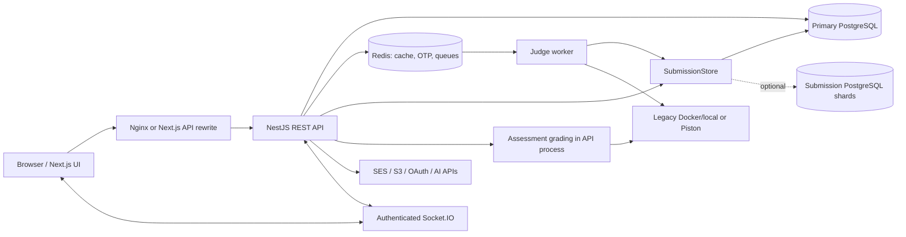

# CodeSkill architecture and onboarding

## Scope and evidence

This guide describes the repository inspected and audited against the active codebase (including learning modules, bug tracking, proctoring, and security remediations). It is an evidence-based analysis of application and infrastructure source. Runtime availability, installed dependency versions, performance, and deployed infrastructure are determined from verified repository configuration and code.

Discovery excluded `node_modules`, `nodemodules`, `target`, `build`, `dist`, `.git`, `.next`, and lockfiles. All three `package.json` manifests and Compose manifests were inspected. Versions below are manifest declarations.

Paths in this document are relative to the repository root. Implementation takes precedence over older prose in `README.md`, `REPOSITORY_OVERVIEW.md`, and historical migration notes where they disagree.

## System shape

CodeSkill is an educational assessment and coding platform with public practice problems, timed contests, proctored assessments, student administration, and company/campus portals. It is principally a modular NestJS application and a Next.js application, with an independently started judge process sharing the backend codebase. These are not independently owned domain microservices. Evidence: `backend-nestjs/src/app.module.ts`, `backend-nestjs/src/worker.ts`, `ecosystem.config.js`, `frontend-v2/src/app/layout.tsx`.

The graph shows intended connections supported by source, not a verified deployment. In particular, the separate worker's gateway delivery has a wiring gap described below. The API prefix is `/api`, Swagger is `/api/docs`, and the HTTP listener defaults to 5001. Next.js defaults to 3000. Nginx forwards `/api` and `/socket.io/` to the API. Next.js also rewrites `/api/:path*` to the backend. Evidence: `backend-nestjs/src/main.ts`, `nginx.conf`, `frontend-v2/next.config.ts`, `ecosystem.config.js`.

## Technology and infrastructure

| Layer | Declared implementation | Evidence |
| --- | --- | --- |
| Languages/tooling | TypeScript for applications; JavaScript/MJS and Bash for operations; HCL for infrastructure; `csvgen.py` for data generation. CI selects Node 22. | `backend-nestjs/tsconfig.json`, `frontend-v2/tsconfig.json`, `.github/workflows/deploy.yml`, `terraform/versions.tf`, `csvgen.py` |
| Frontend | Next.js 16.2.9 App Router, React 19.2.4, Tailwind 4, Axios, Zustand, Monaco, React PDF, GSAP/Framer Motion, shadcn/Base UI primitives. Builds explicitly use Webpack. | `frontend-v2/package.json`, `frontend-v2/postcss.config.mjs`, `frontend-v2/components.json` |
| Backend | NestJS 11, Express platform, TypeORM declared as `^1.1.1` (50 entities across domain, learning, and bug tracking), `pg`, Passport/JWT, class-validator/class-transformer, Swagger, Socket.IO. | `backend-nestjs/package.json`, `backend-nestjs/src/main.ts`, `backend-nestjs/src/database/database.module.ts` |
| GraphQL | Apollo integration with generated schema; only a `ping` health resolver was found. REST carries the business API. | `backend-nestjs/src/app.module.ts`, `backend-nestjs/src/health/health.resolver.ts` |
| Persistence | PostgreSQL; local Compose uses 15-alpine, Terraform RDS specifies engine 14/15. UUID entities with substantial JSONB/array fields. No active MongoDB connection is configured despite legacy `mongoId`/`_id` names. | `docker-compose.yml`, `terraform/modules/rds/main.tf`, `backend-nestjs/src/database/database.module.ts` |
| Cache and work queues | Redis 7 locally; ElastiCache cluster configuration in Terraform. BullMQ queues `submissions` and `credential-email`; no separate Kafka/RabbitMQ broker found. Redis also carries OTP state, throttles, and Socket.IO pub/sub. | `backend-nestjs/src/app.module.ts`, `backend-nestjs/src/students/students.module.ts`, `backend-nestjs/src/redis/otp.service.ts`, `backend-nestjs/src/gateway/redis-io.adapter.ts`, `terraform/modules/redis/main.tf` |
| Execution | Dual execution runners via Piston and Judge0 with Docker fallback; local processes in development or Docker sandbox in production. Language adapters cover C, C++, Java, Python, JavaScript, TypeScript. | `backend-nestjs/src/execution/execution.service.ts`, `backend-nestjs/src/execution/language-adapters.ts`, `backend-nestjs/src/execution/judge0/`, `backend-nestjs/src/execution/piston/piston.service.ts` |
| Hosting | PM2 starts API, judge, and Next.js. Terraform supplies VPC/subnets/NAT, ALB, EC2 ASG, RDS, Redis, S3/IAM, and CloudWatch dashboard definitions. | `ecosystem.config.js`, `terraform/environments/production/main.tf`, `terraform/modules/asg/main.tf` |
| External services | SES sends OTP/credential mail; S3 stores uploads; Google/GitHub/LinkedIn OAuth handlers; OpenRouter or DeepSeek supplies optional practice hints. | `backend-nestjs/src/emails/email.service.ts`, `backend-nestjs/src/s3/s3.service.ts`, `backend-nestjs/src/auth/auth.service.ts`, `backend-nestjs/src/pet/pet.service.ts` |

### Deployment variants

- **Local infrastructure:** `docker-compose.yml` runs PostgreSQL and Redis, with an optional `shards` profile for two additional PostgreSQL servers on loopback ports 5433/5434. It does not containerize the web applications.
- **PM2 application deployment:** `ecosystem.config.js` starts one fork of each process. The worker exports `PROCESS_ROLE=judge` and `JUDGE_SANDBOX=docker`. `backend-nestjs/src/worker.ts` creates an application context without an HTTP listener, but imports the entire `AppModule` rather than a minimal worker module. Credential-email consumers are registered unconditionally by `backend-nestjs/src/students/students.module.ts`.
- **AWS CI deployment:** `.github/workflows/deploy.yml` runs on pushes to `main`, installs/tests/builds both applications, uploads a mutable `releases/latest.zip` to S3, and requests an ASG instance refresh. It declares OIDC permission but actually configures AWS access-key secrets. `terraform/modules/asg/main.tf` downloads the bundle, installs production dependencies, creates Nginx configuration, retrieves backend environment text from SSM, runs a migration command, and starts PM2.
- **Piston:** `deployment/piston/compose.yaml` requires an immutable image reference and privileged/cgroup access on a dedicated disposable Linux execution host. It exposes Piston only on host loopback and uses an internal network; `deployment/piston/nginx.conf` supplies the proxy. `compose.provision.yaml` temporarily permits network access for trusted provisioning. `scripts/piston/preflight.sh`, `provision.mjs`, `smoke.mjs`, and `load.mjs` provide operational checks. The Terraform execution-host module exists at `terraform/modules/piston-execution/main.tf` but is not instantiated by the inspected dev/production environment compositions.
- **Infrastructure options versus enabled resources:** WAF and Route53 module definitions exist, but their environment module calls are commented out. Production currently selects `t3.micro` application instances and `multi_az = false` for RDS. Do not infer Multi-AZ database resilience or enabled WAF from the README. Evidence: `terraform/environments/production/main.tf`, `terraform/modules/waf/main.tf`, `terraform/modules/route53/main.tf`.

## Repository map

| Top-level path | Responsibility and useful starting points |
| --- | --- |
| `backend-nestjs/` | API/worker source, entity definitions, migrations, unit/integration tests, and backend operational notes. Start at `src/main.ts`, `src/app.module.ts`, `src/worker.ts`, and `package.json`. |
| `frontend-v2/` | Next.js application, client state/API wrappers, editors, proctoring hooks, reports, tests, and static branding/fonts. Start at `src/app/layout.tsx`, `src/components/Providers.tsx`, `src/config/api.ts`. |
| `deployment/` | Piston-specific Compose, proxy, and environment templates in `deployment/piston/`. |
| `terraform/` | AWS module library and independently composed `environments/dev/` and `environments/production/`. Root provider/version/variable files are not a substitute for the environment compositions. |
| `scripts/` | Deployment, backup, cleanup, administrator/seed utilities, and Piston provisioning/validation. These scripts have operational side effects. |
| `.github/` | Build/deploy workflow and Piston contract-validation workflow. |
| `docs/` | Execution audit at `docs/piston-audit.md`; additional database/remediation notes live in `backend-nestjs/docs/`. |
| Root files | `package.json` and `build.sh` coordinate builds; `ecosystem.config.js` controls PM2; `nginx.conf` is a proxy template; `deploy-ec2-no-docker.sh` and `fix-*.sh` are alternate/repair scripts. Root CSVs and `csvgen.py` supply import data; `test_apis.js` and `test_multi_attempt_e2e.js` are manual API probes outside Jest discovery. |

### Backend module boundaries

All paths in this table are under `backend-nestjs/src/`; the named controller/service/module files are the evidence for each responsibility.

| Module | Responsibility |
| --- | --- |
| `auth/` | Registration, password/student/admin login, OTP/OAuth, password reset/change, access tokens, refresh rotation, logout. `auth.controller.ts`, `auth.service.ts`, `token.service.ts`. |
| `users/` | Public profiles and XP leaderboard. `users.controller.ts`, `users.service.ts`. |
| `problems/` | Public practice catalog and internal resolution of judge data across three content representations. `problems.service.ts`. |
| `questions/` | Question-bank authoring, validation, approval/publication, import, and banks. `questions.controller.ts`, `questions.service.ts`, `dto/create-question.dto.ts`. |
| `submissions/` | Authenticated saved submission enqueueing, status/history, cancellation. `submissions.controller.ts`, `submissions.service.ts`. |
| `execution/` | Ad hoc run endpoints, queue processor, output comparison, language adapters, sandbox/provider integrations. `execution.controller.ts`, `judge.processor.ts`. |
| `assessments/` | Admin assessment management and student start/save/submit/result lifecycle. `assessments-admin.controller.ts`, `assessments-student.controller.ts`, `assessments.service.ts`. |
| `contests/` | Public contest listing/registration, attempts, violations, reattempt grants, and leaderboards. `contests.controller.ts`, `contests.service.ts`. |
| `exam-security/` | Secure-exam sessions, heartbeat, and recorded security events. `exam-security.service.ts`. |
| `admin/` | Cross-domain dashboard/users/problems/contests/company/university administration. `admin.module.ts`, `admin.service.ts`, `controllers/`. |
| `students/` | Student import/update/deactivation/password reset and credential-mail jobs. `students.service.ts`, `credential-email.processor.ts`. |
| `companies/`, `campus/` | Organization creation, profile reads/updates, memberships. Some frontend job/team/batch API wrappers lack corresponding routes in these backend controllers. `companies/company.controller.ts`, `campus/campus.controller.ts`, `frontend-v2/src/config/api.ts`. |
| `discussions/` | Problem threads, replies, ownership checks, voting. `discussions.service.ts`. |
| `analytics/`, `reports/` | Assessment aggregation and authorized PDF delivery. `analytics.service.ts`, `reports.controller.ts`. |
| `pet/` | Authenticated practice tutor using public problem context, optional AI provider, and local fallback. `pet.service.ts`. |
| `learning/` | Learning paths, courses, modules, lessons, course exercises, practice evaluation, XP/badge gamification, and verifiable certificates. `learning.module.ts`, `services/`, `controllers/`. |
| `bugs/` | Bug reports, screenshot attachments, status transitions, triage, comments, and activity audit logging. `bugs.controller.ts`, `bugs.service.ts`. |
| `database/` | TypeORM registration, all entities, manual migration runners, submission storage/sharding. `database.module.ts`, `sharding/submission-store.ts`. |
| `common/`, `config/` | Guards/decorators, response/error/logging pipeline, runtime configuration. `common/guards/admin.guard.ts`, `config/index.ts`. |
| `redis/`, `gateway/`, `emails/`, `s3/`, `health/` | Cache/OTP/throttle support, real-time transport, mail, storage, and health endpoints. Respective service/controller/module files. |

### Frontend organization and state

`frontend-v2/src/app/` contains file-based routes for public pages, `(auth)`, student login, profiles, problems, assessments, contests, learning paths (`/learning`, `/learning/[pathSlug]`, `/learning/[pathSlug]/[courseSlug]`), certificate verification (`/verify/[credentialId]`), skill development, and `admin/`, `company/`, `campus/` portals. Bracket segments supply route parameters; for example, `frontend-v2/src/app/problems/[id]/page.tsx` fetches a problem by slug even though the segment is called `id`.

`frontend-v2/src/config/api.ts` centralizes Axios and domain API wrappers, bearer-token attachment, transparent token rotation on 401 via `/auth/refresh`, URL normalization, and recursive `id`/`_id` compatibility. `frontend-v2/src/lib/api-base-url.ts` resolves browser API origins. API results are not uniformly unwrapped; callers depend on backend-specific envelopes.

`frontend-v2/src/components/Providers.tsx` composes auth/theme, conditional Google OAuth, and toast providers. `frontend-v2/src/context/AuthContext.tsx` stores the current user in React context and access/refresh tokens in localStorage, revoking refresh tokens on logout. `frontend-v2/src/context/ThemeContext.tsx` handles theme state. Zustand powers authoring stores; `frontend-v2/src/store/createProblemStore.ts` persists drafts via IndexedDB (`idb-keyval`), while route-local stores include `frontend-v2/src/app/admin/questions/create/_store/useQuestionStore.ts` and `frontend-v2/src/app/admin/assessments/create/_store/useAssessmentStore.ts`.

Editors and assessment screens keep substantial local component state and localStorage drafts. Common UI is in `frontend-v2/src/components/ui/`; report implementations are spread across `components/pdf/` and `components/reports/`. `frontend-v2/src/hooks/anti-cheat/useAntiCheatMaster.ts` combines fullscreen/tab/keyboard/copy-paste/devtools hooks and supplies bearer tokens during socket handshake; `frontend-v2/src/hooks/useAssessmentMedia.ts` manages camera/audio lifecycle. The practice mascot uses `frontend-v2/src/components/pet/PracticePet.tsx` and a Transformers speech worker at `frontend-v2/src/components/pet/speech.worker.ts`.

## Domain and persistence

There are 34 entity definition files under `backend-nestjs/src/database/entities/` and 16 entity definition files under `backend-nestjs/src/learning/entities/` (total 50 entities), explicitly registered in `backend-nestjs/src/database/database.module.ts`. Most use UUID primary keys; many retain nullable legacy `mongoId`. Mixed camelCase and snake_case properties/column names are established compatibility constraints.

| Domain | Models and relationships | Exact entity evidence under `backend-nestjs/src/` |
| --- | --- | --- |
| Identity | `User` holds roles, account state, password hash, token version, profile/stats, solved/bookmarked IDs. `RefreshToken` stores a hash, user UUID, family/revocation/expiry; its user ID is a column, not a declared ORM relation. | `database/entities/user.entity.ts`, `database/entities/refresh-token.entity.ts` |
| Practice content | Legacy `Problem`; richer `ProblemMetadata` with one-to-one statement/config/testcase records; coding `Question` can also be explicitly published to practice. | `database/entities/problem.entity.ts`, `database/entities/problem-metadata.entity.ts`, `database/entities/problem-statement.entity.ts`, `database/entities/problem-config.entity.ts`, `database/entities/problem-testcase.entity.ts`, `database/entities/question.entity.ts` |
| Submissions | User UUID, polymorphic problem UUID plus `problemSource` (`problem`, `metadata`, `question`), code/language/verdict/timing/results. The legacy problem relation deliberately disables FK creation. | `database/entities/submission.entity.ts` |
| Assessments | `Assessment` holds question ID arrays, section/target/proctoring configuration, schedule and attempt limits. `AssessmentAttempt` relates to assessment/student and embeds responses, scores and violations. | `database/entities/assessment.entity.ts`, `database/entities/assessment-attempt.entity.ts` |
| Question banks | `Question` carries MCQ/coding content, answers, publication metadata, creator/approver. `QuestionBank` holds UUID arrays, topic and creator. Array membership is not a join-table FK. | `database/entities/question.entity.ts`, `database/entities/question-bank.entity.ts` |
| Contests | `Contest` embeds problem/participant IDs and publication/security configuration. `ContestAttempt` relates to contest/user, with unique contest/user/attempt-number key. `ContestReattemptGrant` records quota, expiry and use. | `database/entities/contest.entity.ts`, `database/entities/contest-attempt.entity.ts`, `database/entities/contest-reattempt-grant.entity.ts` |
| Organizations | `CompanyUser` joins users/companies; `Job` belongs to a company; `Application` relates job/company/user. `UniversityUser` joins users/universities; `Batch` belongs to a university; `StudentEnrollment` relates student/batch/university. | `database/entities/company.entity.ts`, `database/entities/company-user.entity.ts`, `database/entities/job.entity.ts`, `database/entities/application.entity.ts`, `database/entities/university.entity.ts`, `database/entities/university-user.entity.ts`, `database/entities/batch.entity.ts`, `database/entities/student-enrollment.entity.ts` |
| Social | `Discussion` uses a problem ID plus author relation; replies relate to discussion/author and optional parent reply. Vote membership is stored in arrays. | `database/entities/discussion.entity.ts`, `database/entities/discussion-reply.entity.ts` |
| Operational records | `ExamSession` relates candidate/assessment; security events relate session/candidate/assessment. `AuditLog` carries actor/target/event metadata. `EmailJob` relates student and retains temporary password (`select: false`) cleared on delivery. | `database/entities/exam-session.entity.ts`, `database/entities/exam-security-event.entity.ts`, `database/entities/audit-log.entity.ts`, `database/entities/email-job.entity.ts` |
| Bug tracking | `BugReport` tracks system issues with status and priority; `BugImage` stores S3 screenshot links; `BugComment` records triage discussions; `BugActivity` logs status changes and assignments. | `database/entities/bug-report.entity.ts`, `database/entities/bug-image.entity.ts`, `database/entities/bug-comment.entity.ts`, `database/entities/bug-activity.entity.ts` |
| Learning & Certification | `LearningPath` defines curriculum sequence with `LearningPathCourse`; `Course` contains `CourseModule`, `Lesson`, and `CourseExercise`; `LearningEnrollment`, `LessonProgress`, `CourseProgress`, and `PathProgress` track completion; `XPLedger`, `BadgeDefinition`, `StudentBadge` power gamification; `CertificateTemplate`, `Certificate`, `CertificateEvent` manage verifiable credentials. | `learning/entities/` (16 entities) |

### Submission sharding and migrations

`backend-nestjs/src/database/sharding/submission-store.ts` wraps the normal repository and optionally routes submissions to independent PostgreSQL databases. `sharding.config.ts` hashes normalized user UUIDs with MD5 into 128 fixed buckets assigned to stable shard IDs. This is deterministic routing, not password hashing. `shard-registry.ts` and `sharding-state.ts` validate topology/identity; primary-domain data remains in the primary database. Scoped queries route to the user's shard; unscoped queries aggregate across shards and user relations are hydrated from primary storage. There is no cross-database transaction spanning verdict and user statistics.

Cutover requires stopped/drained writers and explicit migration flags, preserves IDs, and guards the old primary submissions table. Do not clear `SUBMISSION_SHARDS` as a rollback. Evidence: `backend-nestjs/src/database/sharding/migrate-submission-shards.ts`, `backend-nestjs/docs/submission-sharding.md`.

Schema evolution uses custom SQL functions/runners rather than an established timestamped TypeORM migration-class sequence. `backend-nestjs/src/database/run-practice-submission-source.ts` loads dotenv via `dotenv.config()` and runs 11 migrations in one transaction under a PostgreSQL advisory lock (`pg_advisory_xact_lock(1902230159)`): submission-source, auth-token, declarative partitioning, contest-security, assessment audience targeting, assessment proctor captures, assessment proctoring modes, assessment resume limits, bug reports, learning module, and problem config default language. It skips primary submission alterations when sharding is active. Its filename and older `backend-nestjs/docs/practice-submission-source-migration.md` understate its current scope. `backend-nestjs/typeorm.config.ts` is a separate datasource loading `../.env.ec2`; do not assume a generic TypeORM CLI command reproduces runtime configuration.

`backend-nestjs/src/database/migrations/declarative-partitioning.ts` rebuilds regular submissions/security-event/audit tables as time-range partitions, with dated partitions and a default partition. This differs from multi-server submission sharding. Runtime schema synchronization is enabled only for nonproduction with `DB_SYNCHRONIZE=true`; sharding forbids that combination. `backend-nestjs/src/sync-db.ts` also refuses production synchronization.

## End-to-end operation traces

### 1. Public practice, run, and saved submission

1. `frontend-v2/src/app/problems/page.tsx` requests catalog data through `frontend-v2/src/config/api.ts`. `backend-nestjs/src/problems/problems.controller.ts` delegates to `problems.service.ts`, whose parameterized SQL merges/deduplicates legacy problems, metadata-backed problems, and explicitly published coding questions. Public lists are cached for 300 seconds.
2. `frontend-v2/src/app/problems/[id]/page.tsx` loads by slug. `ProblemsService.getProblemBySlug` checks publication and returns public fields/sample tests; `getExecutionProblem` separately resolves authoritative judge configuration, including hidden tests.
3. The editor's Run action posts code, language, sample tests, and allowed config to `/api/execution/run`. JWT and submission throttling guards execute first. `backend-nestjs/src/execution/execution.controller.ts` validates the request and enqueues a `run-code` job on BullMQ's `submissions` queue.
4. `backend-nestjs/src/execution/judge.processor.ts` invokes `ExecutionService.executeCode`, which chooses legacy execution or Piston and compares outputs. The job result is read through owner-checked `/api/execution/jobs/:jobId`. `frontend-v2/src/lib/await-execution.ts` supports polling; the practice editor also contains its own polling logic.
5. Submit currently first performs the sample run, then calls `/api/submissions`. `backend-nestjs/src/submissions/submissions.service.ts` ignores client-supplied verdict/score fields, resolves server-owned content, validates language/size, saves a queued `Submission` via `SubmissionStore`, reserves an active-job slot in Redis, and enqueues `evaluate-code` using the submission UUID as job ID. The API responds with HTTP 202.
6. The judge loads the saved submission and authoritative tests, claims/finalizes work with database locking, evaluates all tests, redacts hidden-test details, saves the verdict, and updates user statistics in a separate primary transaction. Queue failure paths save error state and release active counters. Evidence: `backend-nestjs/src/execution/judge.processor.ts`, `backend-nestjs/src/submissions/submissions.service.ts`.
7. Submission results/history are owner-checked by `SubmissionsService`; gateway methods attempt private-room events. The current practice Submit UI does not wait for the saved submission's final hidden-test verdict: its immediate panel reflects the preceding sample run. This distinction matters for both UX and future integration work.

### 2. Assessment attempt and reporting

1. Admin authoring goes through `backend-nestjs/src/questions/questions.controller.ts` and `backend-nestjs/src/assessments/assessments-admin.controller.ts`; services persist question/assessment configuration.
2. `frontend-v2/src/app/assessments/[id]/take/page.tsx` uses `studentAssessmentsAPI` to start/resume, autosave, and submit. `backend-nestjs/src/assessments/assessments-student.controller.ts` is JWT-guarded.
3. `AssessmentsService.startStudentAttempt` checks publication state, schedule, and prior attempt counts, fetches questions, and creates/resumes an attempt. Assessment visibility/targeting also has dedicated listing/overview logic; do not assume frontend eligibility alone secures a start operation.
4. `SubmitAssessmentDto` excludes client-supplied grade fields. `AssessmentsService.submitAttempt` resolves the student's latest attempt, checks ownership/finalized status and end time, fetches authoritative questions, grades MCQs, and executes coding responses against stored tests. Coding grading calls `ExecutionService.runCode` directly within the API request, rather than the BullMQ submission flow. It persists response details, totals, highest score, and reported violations.
5. `backend-nestjs/src/exam-security/exam-security.service.ts` separately stores sessions, heartbeat state, and security events. Browser anti-cheat/camera hooks are signals, not proof that a device is locked down.
6. `backend-nestjs/src/reports/reports.controller.ts` checks owner/admin access and streams a React PDF assessment report with no-store headers. `backend-nestjs/src/analytics/analytics.service.ts` aggregates assessment performance. Browser report generation also exists at `frontend-v2/src/components/reports/ContestReportDocument.tsx` and `frontend-v2/src/components/pdf/StudentResultReport.tsx`.

### 3. Contest participation

`frontend-v2/src/app/contests/[id]/attempt/page.tsx` starts a session through `backend-nestjs/src/contests/contests.controller.ts`, displays a start gate, and mounts the shared `ProblemWorkspace`. `ContestsService` checks registration/time window, resumes or creates an attempt, and can consume an administrator-issued reattempt grant. Violation posts carry the session ID; completion computes solved problems and persists attempt totals. Public/member leaderboards respect publication/access rules and include a sharded aggregation branch. Completion scoring itself still queries primary `submissions` directly, so it is not fully sharding-aware. Evidence: `backend-nestjs/src/contests/contests.service.ts`, `frontend-v2/src/components/problems/ProblemWorkspace.tsx`, `frontend-v2/src/hooks/anti-cheat/useAntiCheatMaster.ts`.

### 4. Student onboarding and integrations

`backend-nestjs/src/students/students.controller.ts` accepts import/management operations. `students.service.ts` parses spreadsheet input with `xlsx`, validates preview rows, creates student users and audit/email records, and queues credential delivery. `credential-email.processor.ts` reads `EmailJob`, calls `backend-nestjs/src/emails/email.service.ts` (SES), updates retry/status fields, and clears the temporary password only on success.

Avatar upload uses a memory-backed Multer interceptor in `backend-nestjs/src/auth/auth.controller.ts`, then `backend-nestjs/src/s3/s3.service.ts` uploads and returns an S3 URL; old avatar cleanup runs asynchronously. The optional tutor at `backend-nestjs/src/pet/pet.service.ts` sends bounded student code/question/history and public problem context to OpenRouter/DeepSeek, with local responses/fallback. Hidden judge tests are fetched through a different internal problem method and are not its intended context.

## Cross-cutting behavior

### Authentication and authorization

- `backend-nestjs/src/auth/strategies/jwt.strategy.ts` and `auth/token.service.ts` validate HS256 access credentials, issuer/audience, active account, and live `tokenVersion`. Refresh tokens are random, stored as SHA-256 hashes, single-use rotated, and grouped into revocable families. Password reset/change invalidates prior sessions.
- Password hashing/checks and safe user serialization live in `backend-nestjs/src/database/entities/user.entity.ts`; policy is in `backend-nestjs/src/auth/password.util.ts`. OTP uses purpose-scoped Redis state and atomic verification logic at `backend-nestjs/src/redis/otp.service.ts`; `auth/login-throttle.service.ts` adds login throttling.
- Guards are explicit per controller/route, not a blanket authentication policy. `common/guards/admin.guard.ts` recognizes multiple admin roles and `isAdmin`; `super-admin.guard.ts` is narrower. Several endpoints use narrower inline role comparisons, so role behavior is not uniform. Company/campus updates additionally check membership/privilege in their services.
- `backend-nestjs/src/gateway/app.gateway.ts` authenticates the socket handshake with `TokenService`, joins a private user room, validates contest participation for contest rooms, and applies an in-process event-rate limit. Its production origins come from `CORS_ORIGIN` or `FRONTEND_URL`.
- Administrators are created through `backend-nestjs/src/create-admins.ts`, exposed as `npm run admin:bootstrap`; `config/index.ts` does not automatically promote configured email addresses at startup.

### Validation, errors, and logging

`backend-nestjs/src/main.ts` installs Helmet, compression, and a global `ValidationPipe` with transformation/implicit conversion and whitelisting; unknown DTO fields are stripped rather than rejected. DTO classes carry decorator rules. Routes typed as `any` or inline object types do not gain DTO validation automatically; some services perform manual checks instead.

`backend-nestjs/src/app.module.ts` registers `HttpExceptionFilter`, `ResponseInterceptor`, and `LoggingInterceptor` globally. The response interceptor preserves objects already carrying `success`, wraps arrays as `{success:true,data}`, and spreads ordinary objects alongside `success`. The filter emits `{success:false,message,error:{code,message}}`, joins validation messages, and hides unknown errors behind “Server error”; stack traces go to server console. Logging records method, URL, and elapsed time for successful observable emissions. These implementations assume an HTTP context, a caveat for the GraphQL resolver. Evidence: `backend-nestjs/src/common/filters/http-exception.filter.ts`, `backend-nestjs/src/common/interceptors/response.interceptor.ts`, `backend-nestjs/src/common/interceptors/logging.interceptor.ts`.

Nest Logger and console calls are the observable application logging pattern; declared Winston packages are not evidence of a configured Winston pipeline. PM2 directs output/error logs to `logs/`; Nginx supplies access/error logs. Frontend route/global error boundaries log errors and offer reset controls, with request failures handled through Axios/toasts/local UI. Evidence: `ecosystem.config.js`, `nginx.conf`, `frontend-v2/src/app/error.tsx`, `frontend-v2/src/app/global-error.tsx`.

### Configuration contract

| Area | Variables and behavior | Evidence |
| --- | --- | --- |
| Core | `NODE_ENV`, `PORT`; set `NODE_ENV` explicitly. JWT relaxation only applies to literal `development`/`test`, not unset. | `backend-nestjs/src/config/index.ts`, `backend-nestjs/src/config/jwt.config.ts` |
| Database | `DATABASE_URL` takes precedence, otherwise `DATABASE_HOST/PORT/USER/PASSWORD/NAME/SSL`; nonproduction-only `DB_SYNCHRONIZE`. | `backend-nestjs/src/database/database.module.ts` |
| Tokens | Strong `JWT_SECRET` outside development/test; `JWT_ACCESS_TTL` (or legacy `JWT_EXPIRE`), `JWT_REFRESH_TTL`, `JWT_ISSUER`, `JWT_AUDIENCE`; production access TTL maximum 24h. | `backend-nestjs/src/config/jwt.config.ts` |
| Redis | `REDIS_HOST/PORT/PASSWORD/URL`, `REDIS_CLUSTER_MODE` or `REDIS_ENABLE_CLUSTER`, `REDIS_TLS`, optional `REDIS_CLUSTER_NODES`. BullMQ uses a different production-based cluster switch. | `backend-nestjs/src/redis/redis.service.ts`, `backend-nestjs/src/gateway/redis-io.adapter.ts`, `backend-nestjs/src/app.module.ts` |
| Execution | `PROCESS_ROLE`, `ENABLE_EMBEDDED_JUDGE`, `CODE_EXECUTION_PROVIDER`, `JUDGE_SANDBOX`, `WORKER_CONCURRENCY`, submission rate/concurrency limits. Piston additionally needs base URL and reviewed runtime-version JSON; Azure path needs `AZURE_COMPILER_URL/KEY`. | `backend-nestjs/src/execution/execution.module.ts`, `backend-nestjs/src/execution/piston/piston.config.ts`, `deployment/piston/backend.env.example` |
| Sharding | `SUBMISSION_SHARDS`, `SUBMISSION_SHARD_POOL_SIZE`, optional fixed `SUBMISSION_SHARD_MAP`; same topology on every API/judge. | `backend-nestjs/src/database/sharding/sharding.config.ts` |
| Email/storage/OAuth | AWS credential chain or keys, `AWS_REGION`, `AWS_SES_SENDER`, `AWS_S3_BUCKET_NAME`; provider client IDs/secrets; optional `OTP_PEPPER`. | `backend-nestjs/src/config/index.ts`, `backend-nestjs/src/emails/email.service.ts`, `backend-nestjs/src/redis/otp.service.ts` |
| Frontend/origins | `NEXT_PUBLIC_API_URL`, `INTERNAL_BACKEND_URL`, `NEXT_PUBLIC_GOOGLE_CLIENT_ID`, optional `NEXT_PUBLIC_WS_URL`; gateway uses `CORS_ORIGIN`/`FRONTEND_URL`, not the examples' `CLIENT_URL`. | `frontend-v2/.env.example`, `frontend-v2/src/config/api.ts`, `frontend-v2/next.config.ts`, `backend-nestjs/src/gateway/app.gateway.ts` |
| Tutor | Optional `OPENROUTER_API_KEY/MODEL` or `DEEPSEEK_API_KEY/MODEL`. | `backend-nestjs/src/pet/pet.service.ts` |

## Testing and verification model

At inspection there are 81 backend `*.spec.ts` files under `backend-nestjs/src/` and 64 frontend `*.test.ts(x)` files under `frontend-v2/src/`. Backend Jest uses ts-jest and Node, configured in `backend-nestjs/package.json`; tests commonly instantiate services with mocked repositories/queues or use Nest testing modules. Examples: `backend-nestjs/src/questions/questions.service.spec.ts`, `backend-nestjs/src/auth/auth.security.spec.ts`, `backend-nestjs/src/execution/piston/piston.service.spec.ts`, `backend-nestjs/src/database/sharding/submission-store.spec.ts`.

Frontend Jest uses `next/jest`, jsdom, and the `@/` alias in `frontend-v2/jest.config.ts`; React Testing Library tests mock API/navigation/browser integrations and check loading, failure, interaction, and cleanup behavior. Examples: `frontend-v2/src/__tests__/components/PublicProblems.test.tsx`, `frontend-v2/src/__tests__/hooks/useAssessmentMedia.test.tsx`, `frontend-v2/src/lib/await-execution.test.ts`.

Backend e2e is separately configured by `backend-nestjs/test/jest-e2e.json`; its one `app.e2e-spec.ts` imports the entire app, depends on backing services, and expects a raw “Hello World!” response despite the global response envelope. `backend-nestjs/test/submission-sharding.integration.ts` is a separate ts-node program that creates/drops disposable databases on localhost servers. Root/manual scripts are not part of these Jest suites.

`.github/workflows/deploy.yml` and `.github/workflows/piston-validation.yml` configure CI on Node 22, running validation, unit suites, and build steps. Exact commands and prerequisites are in root `AGENTS.md`.

## Technical debt and red flags

These are source-level findings, not claims of a reproduced exploit or production incident. Prioritize security/data-integrity issues before cosmetic refactors.

| Priority | Finding and implication | Evidence |
| --- | --- | --- |
| High | ASG's SSM-failure branch embeds a literal JWT secret. Length/entropy validation does not make a publicly known secret safe; fallback should fail closed or obtain a fresh managed secret. | `terraform/modules/asg/main.tf`, `backend-nestjs/src/config/jwt.config.ts` |
| High | Assessment grading iterates responses and checks for duplicates. Concurrent start/submit safety needs review because this flow differs from the judge's transactional claim pattern. | `backend-nestjs/src/assessments/assessments.service.ts` (`submitAttempt`), `backend-nestjs/src/assessments/dto/submit-assessment.dto.ts` |
| High | Migration runner rebuilds partitioned tables and executes multiple schema changes, while deployment appends `|| true`. Partition conversion drops legacy tables with `CASCADE` and copies only intersecting columns, requiring explicit dependency/data-preservation review. A failing migration can be followed by app startup. | `backend-nestjs/src/database/run-practice-submission-source.ts`, `backend-nestjs/src/database/migrations/declarative-partitioning.ts`, `terraform/modules/asg/main.tf` |
| High | Contest completion queries the primary `submissions` table rather than `SubmissionStore`, and converts query failures to zero solved. After shard cutover it can score against the stale primary snapshot, even though the leaderboard has shard support. | `backend-nestjs/src/contests/contests.service.ts` (`submitAttempt`, `shardedLeaderboard`), `backend-nestjs/src/database/sharding/submission-store.ts` |
| High | Main-database TLS `rejectUnauthorized` defaults to `isProduction` in `database.module.ts`; HTTP CORS strictly validates request origins via `resolveAllowedCorsOrigins()` and `isOriginAllowed()`. Shard TLS enforces `rejectUnauthorized: true`. | `backend-nestjs/src/database/database.module.ts`, `backend-nestjs/src/main.ts`, `backend-nestjs/src/database/sharding/sharding.config.ts` |
| Medium | Frontend implements transparent token rotation on HTTP 401 in `config/api.ts`, retains `codeskill_refresh_token` in localStorage, and `/auth/logout` revokes the refresh family via `OptionalJwtAuthGuard`. LocalStorage remains the client storage mechanism. | `frontend-v2/src/context/AuthContext.tsx`, `frontend-v2/src/config/api.ts`, `backend-nestjs/src/auth/auth.controller.ts` |
| Medium | Contest anti-cheat socket initialization in `useAntiCheatMaster.ts` transmits the JWT bearer token in `auth.token` and `extraHeaders.Authorization`. The judge worker application context does not bind an HTTP Socket.IO server directly. Live contest/worker events need end-to-end verification. | `frontend-v2/src/hooks/anti-cheat/useAntiCheatMaster.ts`, `backend-nestjs/src/gateway/app.gateway.ts`, `backend-nestjs/src/worker.ts`, `backend-nestjs/src/main.ts` |
| Medium | PM2 production expects Docker execution, but ASG bootstrap and the no-Docker installer do not provision Docker/images. Assessment coding runs within API requests as well. Provisioning and process isolation assumptions are not aligned across paths. | `ecosystem.config.js`, `terraform/modules/asg/main.tf`, `deploy-ec2-no-docker.sh`, `backend-nestjs/src/assessments/assessments.service.ts` |
| Medium | BullMQ chooses Redis Cluster solely from `NODE_ENV=production`; ordinary Redis and Socket.IO clients use explicit cluster/TLS settings. Production templates describing standalone localhost Redis can therefore fail or behave inconsistently. | `backend-nestjs/src/app.module.ts`, `backend-nestjs/src/redis/redis.service.ts`, `backend-nestjs/.env.example.ec2` |
| Medium | Environment examples contain placeholder secrets and 30-day access TTLs rejected by current strict startup checks. The local example omits explicit `NODE_ENV`. The migration runner loads dotenv automatically via `dotenv.config()`. | `backend-nestjs/.env.example.local`, `backend-nestjs/.env.example.ec2`, `backend-nestjs/src/config/jwt.config.ts`, `backend-nestjs/docs/practice-submission-source-migration.md`, `backend-nestjs/src/database/run-practice-submission-source.ts` |
| Medium | Submit UI displays the sample run result and only logs saved-submission failures; it does not reconcile the queued final verdict. The public editor and contest workspace duplicate large amounts of this behavior. | `frontend-v2/src/app/problems/[id]/page.tsx`, `frontend-v2/src/components/problems/ProblemWorkspace.tsx` |
| Medium | Routing collisions: `@Get(':id')` precedes `recent`/`stats` in submissions, and campus declares both `:id` and `:username` GET patterns. These have ambiguous/shadowed Express route behavior and need HTTP-level tests. Portal API wrappers also describe job/team/batch endpoints absent from inspected controllers. | `backend-nestjs/src/submissions/submissions.controller.ts`, `backend-nestjs/src/campus/campus.controller.ts`, `backend-nestjs/src/companies/company.controller.ts`, `frontend-v2/src/config/api.ts` |
| Medium | `typescript.ignoreBuildErrors=true` hides frontend type failures during builds. Broad `any`, mixed DTO/manual validation, and services over 1,000 lines increase change risk. No full browser e2e pipeline was found; server e2e appears stale and is not run by CI. | `frontend-v2/next.config.ts`, `backend-nestjs/src/assessments/assessments.service.ts`, `backend-nestjs/src/questions/questions.service.ts`, `backend-nestjs/test/app.e2e-spec.ts`, `.github/workflows/deploy.yml` |
| Medium | Avatar uploads enforce a 2MB limit in `FileInterceptor`. Credential email records mark `temporaryPassword` with `select: false` and the processor purges it after delivery. | `backend-nestjs/src/auth/auth.controller.ts`, `backend-nestjs/src/database/entities/email-job.entity.ts`, `backend-nestjs/src/students/credential-email.processor.ts` |
| Medium | Nontransactional boundaries span submission persistence, Redis reservation, queue insertion, and primary statistics. Partial failure can leave inconsistencies; shard migration notes explicitly disclaim distributed transactions. | `backend-nestjs/src/submissions/submissions.service.ts`, `backend-nestjs/src/execution/judge.processor.ts`, `backend-nestjs/docs/submission-sharding.md` |
| Operational | `scripts/backup.sh` backs up only the primary URL and relies on the caller's working directory; it does not cover active submission shards. Production RDS is single-AZ and WAF is not enabled in the environment composition. | `scripts/backup.sh`, `terraform/environments/production/main.tf` |
| Maintenance | Multiple content representations, `id`/`_id`/`mongoId` compatibility, inconsistent role comparisons, duplicated report/editor implementations, and unversioned release naming increase coupling. Dependency ranges and `--legacy-peer-deps` warrant a separate compatibility/advisory audit. | `backend-nestjs/src/problems/problems.service.ts`, `frontend-v2/src/config/api.ts`, `backend-nestjs/src/submissions/submissions.controller.ts`, `.github/workflows/deploy.yml`, `SECURITY.md`, both application `package.json` files |

No remediation was applied in this analysis. Use the source paths above to scope follow-up work, add targeted regression coverage, and validate behavior against disposable services before changing production operations.
