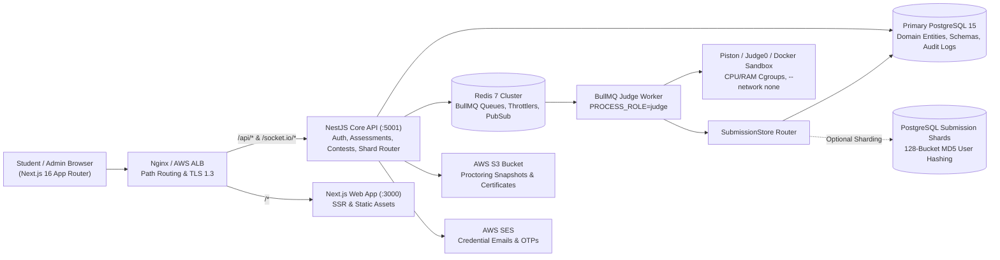

# CodeSkill Repository Overview

## 1. System Purpose & Architecture

**CodeSkill** is an enterprise-scale online examination, technical training, algorithmic judge, and certification platform engineered for **Chandigarh University**. The platform is architected as two decoupled applications sharing a common domain ecosystem:

1. **Backend (`backend-nestjs/`):** A modular NestJS 11 application operating as both an HTTP REST / Socket.IO API server (`PROCESS_ROLE=api`) on port `5001` and an asynchronous BullMQ queue worker (`PROCESS_ROLE=judge`) executing untrusted student code inside isolated sandboxes.
2. **Frontend (`frontend-v2/`):** A Next.js 16.2.9 (App Router) and React 19.2.4 web application running on port `3000`, providing responsive candidate exam workspaces, Monaco code editing, client-side AI proctoring via MediaPipe Vision, real-time contest arenas, faculty/admin management studios, learning curriculum readers, and public credential verification.



---

## 2. Technology Stack

| Layer | Implementation Technologies | Verification Source |
| :--- | :--- | :--- |
| **Backend Framework** | NestJS 11, Express platform, TypeORM `^1.1.1`, Passport, `@nestjs/jwt`, Swagger, `@nestjs/bullmq` | `backend-nestjs/package.json`, `src/main.ts` |
| **Frontend Framework** | Next.js 16.2.9 (App Router, Webpack build), React 19.2.4, Tailwind CSS v4, Monaco Editor, Zustand | `frontend-v2/package.json`, `next.config.ts` |
| **Data Persistence** | PostgreSQL 15 with declarative range partitioning; TypeORM entity management (50 registered entities) | `backend-nestjs/src/database/` |
| **Horizontal Sharding** | `SubmissionStore` deterministic 128-bucket MD5 user hashing across independent PostgreSQL shards | `backend-nestjs/src/database/sharding/` |
| **Queue & Real-Time** | Redis 7, BullMQ 5 (`submissions`, `credential-email`), `@socket.io/redis-adapter` for multi-node WebSocket pub/sub | `backend-nestjs/src/app.module.ts`, `gateway/` |
| **Execution Sandboxes** | Dual runner architecture: Piston execution microservice and Judge0 failover; local Docker containerization | `backend-nestjs/src/execution/` |
| **Client-Side AI** | MediaPipe Tasks Vision (`@mediapipe/tasks-vision`) & `@vladmandic/human` for facial landmark detection | `frontend-v2/src/hooks/anti-cheat/` |
| **Cloud & DevOps** | AWS ALB, ASG, RDS, ElastiCache Redis, S3, SES; Terraform configurations; PM2 process clustering | `terraform/`, `ecosystem.config.js` |
| **Runtime & CI** | Node.js 22 LTS across GitHub Actions CI workflows (`deploy.yml`, `piston-validation.yml`) | `.github/workflows/` |

---

## 3. Repository Directory Structure

```
codeskill/
├── .github/                      # CI/CD workflows (ECR build, ASG rolling refresh, Piston validation)
├── .local-dev/                   # Local development environment notes and configuration templates
├── backend-nestjs/               # NestJS backend API and judge worker package
│   ├── docs/                     # Architectural guides, sharding, failover, and migration notes
│   ├── scripts/                  # Build orchestration scripts (node scripts/build.js)
│   ├── src/                      # Source code (27 feature and infrastructure modules)
│   │   ├── admin/                # Cross-domain administrative management
│   │   ├── assessments/          # Examination engine, timers, grading, and proctoring penalties
│   │   ├── auth/                 # JWT authentication, refresh token rotation, OAuth, password reset
│   │   ├── bugs/                 # Bug reporting, screenshot attachments, status updates, comments
│   │   ├── campus/ & companies/  # University batch enrollment and company recruitment portals
│   │   ├── contests/             # Competitive programming arena, ACM-ICPC scoring, leaderboards
│   │   ├── database/             # 34 core entities, migrations, and submission sharding store
│   │   ├── execution/            # BullMQ judge processor, Piston & Judge0 runners, adapters
│   │   ├── learning/             # Learning paths, courses, modules, lessons, gamification, certificates
│   │   ├── problems/             # Practice catalog and execution problem resolution
│   │   ├── questions/            # Question bank studio, approval moderation, bulk CSV/XLSX import
│   │   ├── redis/                # OTP service, distributed throttlers, Redis client provider
│   │   ├── students/             # Bulk student onboarding, deduplication, credential email worker
│   │   ├── users/                # Public sanitized user profiles and XP leaderboards
│   │   └── worker.ts             # Dedicated judge worker entrypoint (PROCESS_ROLE=judge)
│   └── test/                     # Integration tests and E2E configuration
├── deployment/                   # Piston execution templates, Nginx proxy, Uptime Kuma monitoring
├── docs/                         # Engineering audits, learning module architecture, remediation reports
├── ecosystem.config.js           # Production PM2 process configuration for API, worker, and frontend
├── engineering-audit-independent/# Independent 14-part pre-production engineering audit reports
├── frontend-v2/                  # Next.js 16 App Router frontend package
│   ├── src/
│   │   ├── app/                  # Route handlers and pages (assessments, contests, learning, admin)
│   │   ├── components/           # UI components, Monaco editor, PDF scorecards, practice mascot
│   │   ├── config/               # API client (Axios with auto-refresh), authentication, navigation
│   │   ├── context/              # AuthContext (token rotation/revocation), ThemeContext
│   │   ├── hooks/                # Anti-cheat master, assessment media, web workers
│   │   └── lib/                  # Polling helpers, logger, mutation notifications, execution await
├── nginx.conf                    # Production reverse proxy configuration template
├── package.json                  # Root coordination manifest (local dev, builds, PM2 management)
├── scripts/                      # Operational utilities (database backups, local dev seeding, k6 tests)
└── terraform/                    # Modular AWS infrastructure (VPC, ALB, ASG, RDS, Redis, Budgets)
```

---

## 4. Key Functional Modules

### 4.1 Examination & Assessment Engine (`assessments/`)
- **Server-Authoritative Timing:** Candidate attempts enforce strict start/end deadlines on the server; expired attempts are rejected.
- **Section-Based Distribution & Randomization:** Supports MCQ option shuffling per attempt, section-based question limits, and negative marking.
- **Proctoring Penalties:** Integrates violation counts directly with attempt score calculation.
- **Autosave & Resume:** State persistence across browser restarts with configurable maximum resume counts.

### 4.2 Multi-Language Sandboxed Execution (`execution/`)
- **Supported Languages:** Python 3, C++17/C++20, Java 21, C11, TypeScript, JavaScript (Node.js).
- **Dual Execution Fleet:** Primary evaluation via Judge0 with automated failover to Piston on connection failures, sandbox unhealthy states, or fleet saturation.
- **Strict Isolation:** Enforces `--network none`, non-root user execution, memory limits (512MB RAM), CPU execution deadlines, and local output comparison.

### 4.3 AI Anti-Cheat & Proctoring Studio (`exam-security/` & `frontend-v2/src/hooks/`)
- Client-side facial landmark tracking using MediaPipe Vision.
- Detection and telemetry for multiple faces, candidate absence, gaze deflection, tab switches, and fullscreen exits.
- Automated webcam snapshot frame uploads to AWS S3 via presigned URLs.
- Real-time administrative proctoring monitoring and automatic exam submission on violation limit exhaustion.

### 4.4 Learning Paths & Certification (`learning/`)
- **Curriculum Architecture:** Hierarchical structure of `LearningPath` → `Course` → `CourseModule` → `Lesson` → `CourseExercise`.
- **Structured Reading (No Video Dependency):** Rich reading modules with interactive code snippets and knowledge checks.
- **Gamification Engine:** Append-only `XPLedger` with event idempotency, skill category levels, and badge awards (`StudentBadge`).
- **Cryptographic Verification:** Verifiable digital certificates (`CS-YYYY-XXXXXX`) backed by React PDF generation and a public verification portal at `/verify/[credentialId]`.

### 4.5 Horizontal Submission Sharding (`database/sharding/`)
- `SubmissionStore` hashes normalized user UUIDs into 128 virtual buckets mapped to physical PostgreSQL shard pools.
- Write-heavy submission traffic is decoupled from relational user and question tables, preventing lock contention during large exams.
- Cross-shard aggregation utilities hydrate user profiles from the primary database.

### 4.6 Bulk Onboarding & Email Dispatch (`students/`)
- Validates and deduplicates XLSX/CSV student rosters (UID, email, name, batch, semester).
- Transactional insertion of student accounts with `forcePasswordChange: true`.
- Background dispatch of temporary credentials via BullMQ (`credential-email`) and AWS SES. Plaintext temporary passwords are kept non-selectable (`select: false`) and purged after delivery.

---

## 5. Persistence & Data Model

CodeSkill manages **50 domain entities** registered in `DatabaseModule`:

1. **Identity & Auth (2):** `User`, `RefreshToken`
2. **Practice & Catalog (6):** `Problem`, `ProblemMetadata`, `ProblemStatement`, `ProblemConfig`, `ProblemTestCase`, `Question`
3. **Question Banks (1):** `QuestionBank`
4. **Assessments & Exams (2):** `Assessment`, `AssessmentAttempt`
5. **Submissions (1):** `Submission`
6. **Contests (3):** `Contest`, `ContestAttempt`, `ContestReattemptGrant`
7. **Organizations & Cohorts (6):** `Company`, `CompanyUser`, `Job`, `Application`, `University`, `UniversityUser`, `Batch`, `StudentEnrollment`
8. **Discussions (2):** `Discussion`, `DiscussionReply`
9. **Operations & Audit (4):** `AuditLog`, `EmailJob`, `ExamSession`, `ExamSecurityEvent`
10. **Bug Tracking (4):** `BugReport`, `BugImage`, `BugComment`, `BugActivity`
11. **Learning & Certification (16):** `LearningPath`, `LearningPathCourse`, `Course`, `CourseModule`, `Lesson`, `CourseExercise`, `LearningEnrollment`, `LessonProgress`, `CourseProgress`, `PathProgress`, `XPLedger`, `BadgeDefinition`, `StudentBadge`, `CertificateTemplate`, `Certificate`, `CertificateEvent`

---

## 6. Testing & Quality Assurance

The codebase maintains extensive automated test suites:

- **Backend Unit & Security Suites:** 81 Jest specification files (`npm test --prefix backend-nestjs -- --runInBand`).
- **Frontend Test Suites:** 64 React Testing Library suites (`npm test --prefix frontend-v2 -- --runInBand`).
- **Compilation & Type-Checking:**
  - Backend: `(cd backend-nestjs && npx --no-install tsc -p tsconfig.build.json --noEmit --incremental false)`
  - Frontend: `(cd frontend-v2 && npx --no-install tsc --noEmit --incremental false)`
- **Load Testing:** k6 assessment stress scripts in `scripts/k6/` and `terraform/load-tests/` simulating 100 to 2,000 concurrent students.
- **CI Pipelines:** GitHub Actions workflows (`.github/workflows/deploy.yml` and `piston-validation.yml`) executing tests, linting, and builds on Node.js 22.
