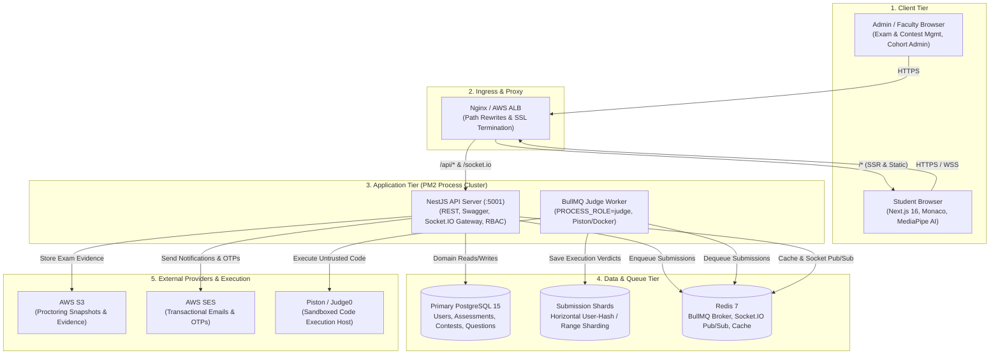

# CodeSkill Platform — High-Level Design (HLD) Architecture

This document provides the canonical architectural blueprint and High-Level Design (HLD) for the CodeSkill assessment and algorithmic skill platform, matching the production topology and process clustering model.

---

## 1. System Architecture Diagram

```
                                      +-------------------------------------------------------+
                                      |                      CLIENT TIER                      |
                                      |                                                       |
                                      |  +---------------------------+  +-------------------+ |
                                      |  |  Admin / Faculty Browser  |  |  Student Browser  | |
                                      |  |  Exam & Contest Mgmt      |  |  Next.js 16       | |
                                      |  |  Cohort Administration    |  |  Monaco Editor    | |
                                      |  |  Question Bank Validation |  |  MediaPipe AI     | |
                                      |  +---------------------------+  +-------------------+ |
                                      +-------------------------------------------------------+
                                                    | HTTPS                        | HTTPS / WSS
                                                    +---------------+  +-----------+
                                                                    |  |
                                                                    v  v
                                      +-------------------------------------------------------+
                                      |                    INGRESS & PROXY                    |
                                      |                                                       |
                                      |  +-------------------------------------------------+  |
                                      |  | Nginx Reverse Proxy / AWS Application Load      |  |
                                      |  | Balancer (ALB)                                  |  |
                                      |  | Path Rewrites, SSL/TLS Termination, Rate Limits |  |
                                      |  +-------------------------------------------------+  |
                                      +-------------------------------------------------------+
                                                |                                    |
                                                | /* (SSR / Static Assets)           | /api/* & /socket.io/* (WSS)
                                                v                                    v
                            +-------------------------+            +------------------------------------+
                            |   FRONTEND WEB APP      |            |         APPLICATION TIER           |
                            |   Next.js 16 (Port 3000)|            |       [PM2 Process Cluster]        |
                            +-------------------------+            |                                    |
                                                                   |  +-------------------------------+ |
                                                                   |  | NestJS API Server (:5001)     | |
                                                                   |  | - REST Endpoints / Swagger    | |
                                                                   |  | - Socket.IO Redis Gateway     | |
                                                                   |  | - JWT Auth & Role Guards      | |
                                                                   |  | - Multi-tenant Assessment Svc | |
                                                                   |  +-------------------------------+ |
                                                                   |                 |                  |
                                                                   |                 | Enqueue Jobs     |
                                                                   |                 v                  |
                                                                   |  +-------------------------------+ |
                                                                   |  | BullMQ Judge Worker           | |
                                                                   |  | - PROCESS_ROLE=judge          | |
                                                                   |  | - Piston / Docker Adapter     | |
                                                                   |  | - Judge0 Failover Client      | |
                                                                   |  +-------------------------------+ |
                                                                   +------------------------------------+
                                                                        |          |          |
                      +-------------------------------------------------+          |          +-------------------------+
                      |                                                            |                                    |
                      v                                                            v                                    v
+------------------------------------+                    +------------------------------------+      +------------------------------------+
|         EXTERNAL PROVIDERS         |                    |         DATA & QUEUE TIER          |      |          JUDGE EXECUTION           |
|                                    |                    |                                    |      |                                    |
| +--------------------------------+ |                    | +--------------------------------+ |      | +--------------------------------+ |
| | AWS S3                         | |                    | | Primary PostgreSQL 15          | |      | | Piston / Judge0 Host           | |
| | Proctoring Snapshots & Media   | |                    | | Users, Assessments, Contests,  | |      | | Sandboxed Code Execution       | |
| +--------------------------------+ |                    | | Question Banks, Audit Logs     | |      | | Memory & CPU Cgroups           | |
|                                    |                    | +--------------------------------+ |      | +--------------------------------+ |
| +--------------------------------+ |                    |                                    |      +------------------------------------+
| | AWS SES                        | |                    | +--------------------------------+ |
| | Transactional Emails & OTPs    | |                    | | Submission Shards              | |
| +--------------------------------+ |                    | | Horizontal PostgreSQL Shards   | |
|                                    |                    | | Range / User Hash Sharded      | |
|                                    |                    | +--------------------------------+ |
|                                    |                    |                                    |
|                                    |                    | +--------------------------------+ |
|                                    |                    | | Redis 7 Cluster                | |
|                                    |                    | | BullMQ Broker, Socket.IO PubSub| |
|                                    |                    | | OTP Throttles, Route Cache     | |
|                                    |                    | +--------------------------------+ |
+------------------------------------+                    +------------------------------------+
```

---

## 2. Mermaid Architectural Model



---

## 3. Tier Breakdown & Core Responsibilities

### 3.1 Client Tier
- **Admin / Faculty Interface**:
  - Full Question Bank management (single create, bulk import with option fingerprints, preview & merge strategies).
  - Assessment & Contest authoring (balanced difficulty selection, anti-cheat tolerances, duration windows).
  - Cohort administration & bulk student onboarding with duplicate prevention and cohort assignment.
- **Student Workspace**:
  - Next.js 16 responsive SPA / SSR application.
  - Embedded Monaco editor with language runtime detection and syntax tree helpers.
  - MediaPipe browser AI proctoring: local face verification, tab-switch interception, devtools heuristics, and violation socket beacons.

### 3.2 Ingress & Proxy Tier
- **SSL / TLS Termination**: Managed by AWS ALB or Nginx reverse proxy.
- **Path Routing**:
  - `/*` routed to Next.js SSR / static container on port `3000`.
  - `/api/*` routed to NestJS upstream on port `5001`.
  - `/socket.io/*` upgraded to WebSockets and load-balanced to NestJS WebSocket gateway with sticky session hashing.

### 3.3 Application Tier (PM2 Process Cluster)
Managed via `ecosystem.config.js`:
- **API Server (`PROCESS_ROLE=api`)**:
  - Port `5001`.
  - Cluster mode (`API_INSTANCES > 1`).
  - REST controllers, OpenAPI / Swagger documentation (`/api/docs`), Passport JWT authentication, and TypeORM connection pool.
  - WebSocket gateway (`@WebSocketGateway`) backed by Redis IO Adapter for cross-process broadcast.
- **Judge Worker (`PROCESS_ROLE=judge`)**:
  - Fork mode (`JUDGE_WORKER_INSTANCES >= 1`).
  - No HTTP port binding; listens to BullMQ queues (`submissions`, `credential-email`).
  - Sandboxed execution adapter using local Docker / Piston runner with Judge0 failover.

### 3.4 Data & Queue Tier
- **Primary PostgreSQL 15**:
  - Database: `codeskill_pg`.
  - Stores relational entities (50 domain entities across `users`, `assessments`, `contests`, `questions`, `problem_metadata`, `audit_logs`, `assessment_attempts`, `bug_reports`, and `learning_*` curriculum/certification tables).
- **Submission Shards**:
  - Horizontally partitioned PostgreSQL instances for high-throughput contest and assessment submissions.
  - Eliminates table lock contention during large exams with thousands of concurrent submissions.
- **Redis 7 Cluster**:
  - Queue broker for BullMQ (`submissions`, `credential-email`).
  - Socket.IO Pub/Sub adapter for real-time contest leaderboards, student monitoring, and code run progress.
  - Temporary cache, OTP rate-limiting counters, and session revocation store.

### 3.5 External Providers
- **AWS S3**: Secure bucket storage for exam proctoring webcam snaps, screen captures, and student identity verification.
- **AWS SES**: High-deliverability transactional emails for student onboarding credentials and password reset OTPs.
- **Sandboxed Execution Host**: Piston / Judge0 isolated sandbox enforcing CPU timeouts, memory cgroups, and network isolation for untrusted code execution.

---

## 4. Key End-to-End Execution Flows

### Flow A: Code Submission & Judge Evaluation
1. Student clicks **Submit Code** in Monaco Editor.
2. Next.js dispatches `POST /api/submissions`.
3. NestJS API persists pending submission record and pushes job to BullMQ `submissions` queue via Redis.
4. Judge Worker dequeues job, prepares public & hidden test cases, and dispatches to Piston Sandbox.
5. Sandbox executes code in isolated cgroup; returns stdout, stderr, execution time, and memory.
6. Judge Worker parses output against expected test cases, computes verdict (`ACCEPTED`, `WRONG_ANSWER`, `TLE`, `MLE`), and writes verdict to database.
7. Socket.IO emits completion event to the student's browser room (`submission_${id}`).

### Flow B: Bulk Student Onboarding
1. Admin uploads CSV/Excel file at `/admin/students/import`.
2. Backend parses rows, validates emails, UIDs, and phone formats.
3. System checks database and in-file duplicates.
4. Admin confirms import (`POST /api/admin/students/import/confirm`).
5. Transaction executes: saves student records, generates UUIDs, and inserts corresponding `email_jobs` linked to `student_id`.
6. BullMQ worker dispatches credentials email via AWS SES.

### Flow C: Question Bank & Topic Filtering
1. Admin navigates to `/admin/questions/topics`.
2. Cards display question distribution across topics and difficulties.
3. Clicking **Browse Questions** passes `?topic=TopicName`.
4. `/admin/questions` reads query parameter via `useSearchParams`, sets dropdown state, and fetches filtered dataset from `/api/admin/questions?topic=TopicName`.
5. Backend executes case-insensitive query across `topic`, `subtopic`, and `metadata.categories`.
6. Table rows render cleanly with complete opacity and zero visual blur.
