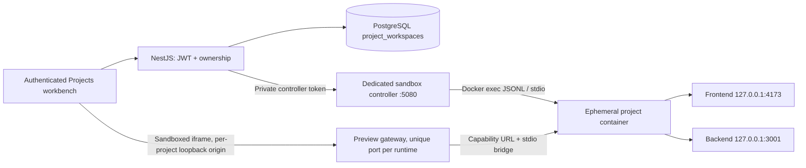

# Project workspaces

Projects are personal, authenticated workspaces at `/projects`, linked from the student, teacher, and admin Labs dashboards. This feature adds no AWS, Terraform, judge, or CI changes.

## Supported stacks

| Part | Choices | Source | Runtime |
| --- | --- | --- | --- |
| Frontend | HTML/CSS/JavaScript, React, Vue, Svelte | `frontend/` | Vite, loopback port 4173 |
| Frontend + built-in server routes | Next.js 16.4.2 | `frontend/app/` | Node.js / Next.js, loopback port 4173 |
| Backend | Java Spring Boot 4.1.2 | `backend/src/main/java/` | Java 17 / Maven, loopback port 3001 |
| Backend | Express, Fastify | `backend/server.js` | Node.js, loopback port 3001 |
| Backend | Flask, FastAPI | `backend/main.py` | Python, loopback port 3001 |

Select frontend-only, backend-only, or combine any frontend/backend. The catalog and starters live in `backend-nestjs/src/projects/project-catalog.ts`. Runtime commands are allowlisted in `deployment/projects/runtime/bridge.mjs`. Add and test both when supporting another stack. Arbitrary Docker images and custom Dockerfiles are deliberately not executed.

The Monaco editor has a file explorer, file tabs, syntax highlighting, create/rename/delete actions, a resizable workbench, console, and bounded command terminal. Enter a path such as `frontend/src/components/Button.jsx` to create folders. The stack picker uses locally bundled Devicon technology logos and keyboard-accessible radio cards. The API client supports methods, JSON headers, request body, response body/headers, status, duration, and response size. Fullstack workspaces provide both Preview and API Client tabs. Next.js workspaces also provide an API Client for built-in server routes when no separate backend is selected. A separate backend owns `/api` when selected alongside Next.js. Next.js project code uses `process.env.NEXT_PUBLIC_PROJECT_BASE` rather than Vite's `import.meta.env.BASE_URL`. Frontend requests to `${import.meta.env.BASE_URL}api/...` reach the same `/api/...` path on the backend. For arbitrary backend routes, `${import.meta.env.BASE_URL}__backend/users` forwards to `/users`; external host URLs are not accepted.

**Format** or **Shift+Alt+F** applies browser-side Prettier formatting to the active file. Supported files format automatically on first open, after paste, and before explicit Save/Apply; the debounced autosave does not interrupt typing. JavaScript/TypeScript and JSX/TSX, JSON, CSS/SCSS/Less, HTML/Vue/Svelte, Markdown, YAML, Java, and XML are supported. Source stays in the browser, parser chunks load on demand, undo boundaries are preserved, and a stale result cannot overwrite newer edits or another file. Syntax errors leave the original source intact. Python and other unsupported files keep normal language indentation (four spaces for Python) and show a disabled Format action. The Java plugin uses its JavaScript-parser release; the exact Chevrotain peer is pinned because XML uses a different parser version. Java cursor mapping uses source-token position because this plugin's CST does not support Prettier's cursor traversal.

Files autosave to PostgreSQL after 1.4 seconds. **Apply changes** or **Cmd/Ctrl+S** saves and synchronizes a running workspace; this restarts its development servers and refreshes the preview. Vite WebSocket HMR is disabled; applying changes restarts its server. Next.js development uses a project-scoped WebSocket tunnel to the fixed frontend port, with at most two sockets per runtime. HTTP assets are compressed through the stdio bridge to keep framework bundles bounded. Files and sessions are not stored exclusively on the Docker host. Save conflicts return 409 without replacing newer files. **Download project ZIP** exports the current source and configuration files, including unsaved editor changes, under a project-named root folder. It refreshes a running workspace first to include terminal-created source files and empty folders, preserves nested paths and UTF-8 contents, and lazy-loads the ZIP library on demand. Dependency/build caches are excluded by the existing source-file synchronization limits. Extract the archive and install the dependencies listed in each stack's manifest to work outside CodeSkill.

The Terminal tab uses xterm.js connected to a persistent Linux Bash pseudo-terminal inside the project container. Working directories, environment variables, history, filename completion, pipes, redirection, interactive input, Ctrl+C/Ctrl+D, ANSI applications, and terminal resizing work normally. Installed tools include coreutils, find, grep, sed, awk, ps/top, Git, curl, less, nano, tree, zip/unzip, and the supported language runtimes. There is one shell per running project. Switching console tabs reconnects to the same shell and retained output; Reconnect restarts the shell. Applying editor files resets the shell along with the disposable workspace. Closing or expiring the project kills it. Package dependencies for supported stacks are preinstalled. Containers cannot download external packages; adding approved packages requires rebuilding the runtime image. The legacy single-command API remains bounded to 15 seconds; the interactive shell lasts until exit or runtime expiry.

Explorer supports a custom right-click menu, New file/New folder toolbar actions, F2 to rename, Delete, and moving files or entire folders by dragging onto a folder or the project root. Creation and renaming use an inline name field: Enter confirms and Escape or clicking away cancels. Validation errors appear beside that field; deletion uses a custom confirmation dialog. Folder moves update open editor paths and reject overwrites or moving a folder inside itself. Empty folders autosave alongside files and survive reload, ZIP export, Apply, and runtime expiry.

Explorer reads a bounded, owner-authenticated runtime snapshot every two seconds while the visible workspace is ready. `mkdir`, `touch`, redirects, edits, renames and deletes appear automatically, and imported source files and directories use the existing PostgreSQL autosave. A three-way merge compares SHA-256 content hashes and directory sets against the last runtime snapshot (or applied files on first load), preserves unapplied editor changes and displays conflicts. Apply and Stop refresh files before saving. Unchanged snapshots return a small fingerprint response. Symlinks, binary/oversized files, dependency and generated build directories are not imported; incomplete scans never cause saved-file deletions. Editor limits remain 100 text files, 200 KB per file and 2 MB total. Files created in an inactive/closed browser or beyond these limits remain ephemeral. The runtime scan is capped at 2,000 entries and 500 directories. Deploy the updated runtime image together with the API and frontend for directory synchronization.

Terminal transport passes through the authenticated NestJS API and project ownership checks, then the private runner token. The browser receives neither Docker access nor the runner token. PTY traffic uses bounded authenticated input requests and 15-second output long polls with sequence cursors, a 256 KiB output ring, 64 KiB output pages, at most four waiting readers, and an 8 KiB input-message limit. Input and output routes retain explicit per-user rate limits suitable for terminal traffic. Bash runs as the same nonroot container user with the existing no-network, no-mount, read-only-root, CPU, memory and PID limits. There are no terminal ports, host shells, additional cloud resources, or container privileges.

## Architecture



The container has **no network interface except loopback**, no published ports, host mounts, Docker socket, platform credentials, or app database configuration. The trusted controller forwards requests to only the two fixed loopback ports inside the container. API tester requests accept a relative path, never a destination URL, and do not follow redirects. Platform cookies and hop-by-hop headers are stripped. API tester Authorization is an explicit user-supplied header, never the platform token.

Each container runs UID/GID 1000, `--network none`, read-only root filesystem, all capabilities dropped, no-new-privileges, Docker's default seccomp, 1 CPU for basic stacks or 2 CPUs for Next.js/Spring Boot, bounded memory (1 GiB basic, 1.5 GiB Next.js or Spring Boot, 2 GiB Next.js + Spring Boot), 128 processes, and bounded tmpfs/log storage. Code files are copied through stdio; no bind mounts or Docker socket are provided. Defaults allow 2 active runtimes globally, 1 per user, and a 2048 MiB shared memory admission budget. A heavy runtime can therefore use the budget before the instance-count limit is reached. Set `PROJECT_MEMORY_BUDGET_MB` only after sizing the dedicated VM. Maven dependencies are cached in the read-only image; Spring Boot builds run offline and require no internet access. Runtimes expire after 20 minutes without an editor heartbeat or 60 minutes total. Stopping or expiry removes the container; saved files remain in PostgreSQL. Restarting the controller removes only containers labelled `codeskill.project-runtime=1` on its dedicated daemon.

Every runtime has its own preview origin and capability URL. Locally, the runner uses `localhost` with a unique loopback port for each runtime, avoiding wildcard `.localhost` DNS while keeping projects on distinct browser origins. Ports are not reused during a runner process lifetime. In production, the configured wildcard preview domain remains in use. The gateway verifies the configured preview host and port plus the runtime's capability path. The iframe permits scripts and same-origin browser APIs only on this separate per-project origin, so Next.js history/storage work while the platform and other project origins remain inaccessible. Never share one preview origin across untrusted projects. Its response CSP additionally restricts scripts, assets, connections, forms, and frame ancestors. Never put untrusted preview HTML on the platform origin. The controller token is private to the backend and controller, never a `NEXT_PUBLIC_` value, container variable, preview parameter, or log field.

Containers share the dedicated sandbox VM kernel. These settings reduce exposure but do not constitute a hardened public multi-tenant hosting guarantee. Before internet deployment, use dedicated sandbox hosts, patch and scan images, add authenticated ingress quotas, assess gVisor/Kata or per-project microVM isolation, and load-test admission/cleanup under hostile workloads. Do not place the controller or runtime daemon on the application host, judge host, shared CI runner, or a host with production secrets.

## Local setup

Node 22+ is required for the controller. Docker must use a separate dedicated Linux VM/host.

```bash
# macOS example: creates a NEW profile; does not switch the active context.
colima start --profile codeskill-projects --cpu 2 --memory 3 --disk 16 \
  --vm-type vz --arch aarch64 --mount none --activate=false
export PROJECT_DOCKER_CONTEXT=colima-codeskill-projects
scripts/projects/build.sh
```

For external-disk storage, stop the NEW profile before moving its root and Docker data disks to the mounted APFS external volume, preserve the originals until boot verification, and point that profile's disk symlinks to those external files. Do not move existing judge disks or change a running VM's files. Keep the drive mounted while the VM is running. On this machine the project disks are `/Volumes/CodeSkillProjects/vm-disks/{root.raw,docker.raw}`, backed by `/Volumes/ps5/codeskill-projects.sparseimage`; the profile is `codeskill-projects`. Metadata and sockets remain under `~/.colima`. `--mount none` is verified in the VM; it must not expose the host home directory.

Generate a random token (e.g. `openssl rand -hex 32`). Copy `deployment/projects/runner.env.example` to a gitignored file, fill it, and add matching settings from `deployment/projects/backend.env.example` to the backend environment. Do not commit either filled file. `PROJECT_RUNNER_URL` must refer to a private trusted controller endpoint. The controller API binds loopback; a remote deployment should reach it over a private authenticated TLS tunnel/reverse proxy rather than publishing port 5080.

```bash
# From repo root, after configuring environment:
node --env-file=.local-dev/projects.env deployment/projects/runner.mjs
# Separate terminal; creates/updates only project_workspaces and its index:
(cd backend-nestjs && NODE_ENV=development npm run db:projects:migrate)
# Restart API after installing the new module/configuration.
```

Open `http://localhost:3000/projects` or `http://127.0.0.1:3000/projects`. Locally the preview uses `http://localhost:<unique-port>/p/<capability>/`. Its frame policy permits both HTTP loopback aliases on the application port configured in `PROJECT_APP_ORIGIN`; other ports and external hosts are not added. In production configure wildcard DNS and a wildcard TLS certificate for `*.preview.example.com`, set `PROJECT_PREVIEW_ORIGIN=https://preview.example.com`, and preserve both the incoming Host header and capability path in its reverse proxy. Proxy WebSocket upgrades too. Production frame policy accepts only the exact configured application origin. This task does not create DNS or TLS infrastructure. Set the app origin exactly, including port. The controller and preview ports, origins, image, capacity, and TTLs are documented in `runner.env.example`. Raising capacity requires sufficient VM memory/CPU; do not increase it on the existing small judge hosts.

Local managed service: `.local-dev/launch-agents/com.codeskill.local.projects.plist`. Its private environment is `.local-dev/projects.env`. Startup/shutdown use launchctl like the other local services. Runner logs are `.local-dev/projects.launchd.{out,err}.log`.

## Database and rollout

Run `npm run db:projects:migrate` in the backend environment after backing up production and before deploying project routes. The migration is additive and idempotent, including the JSONB `directories` column for existing project tables. The table stores owner UUID, name, mode, selected stacks, JSONB files and directories, revision, and timestamps. All project/file/runtime endpoints require a currently valid JWT and matching owner. Admin and teacher roles do not automatically grant access to other users' personal projects. Existing migrations, schemas, submissions, and grading are unchanged.

Rollback: stop the project controller to remove disposable containers, remove its Labs links/routes/module in a subsequent reviewed release, and retain the additive table so student work is not lost. No infrastructure destroy or database drop is needed. Disabling the runtime preserves editor access to saved projects. A runtime controller outage makes execution unavailable but does not delete files.

## Verification

```bash
node --test deployment/projects/runner.test.mjs deployment/projects/terminal.test.mjs deployment/projects/runtime/workspace-files.test.mjs
(cd backend-nestjs && npm test -- --runInBand --watchman=false --runTestsByPath src/projects/projects.service.spec.ts)
(cd frontend-v2 && npm test -- --runInBand --watchman=false --runTestsByPath src/lib/project-workspace.test.ts src/lib/project-files.test.ts src/lib/project-download.test.ts src/__tests__/components/ProjectTerminal.test.tsx)
node scripts/projects/format-smoke.mjs
(cd frontend-v2 && npm test -- --runInBand --watchman=false --runTestsByPath src/lib/project-format.test.ts src/__tests__/components/ProjectCodeEditor.test.tsx)
(cd frontend-v2 && npm test -- --runInBand --watchman=false --runTestsByPath src/lib/project-explorer.test.ts src/__tests__/components/ProjectExplorer.test.tsx)
# Explicit integration test: creates/deletes its own test projects, needs a disposable user.
PROJECT_TEST_EMAIL=... PROJECT_TEST_PASSWORD=... node scripts/projects/smoke.mjs
```

Smoke testing covers all 10 standalone stacks and three mixed fullstack combinations, HTTP preview, frontend-to-backend gateway routing, GET/POST API responses, nonroot UID, loopback-only interfaces, missing credentials/socket, revoked stopped previews, runtime cleanup, and durable files. Browser verification must also check script execution and frontend interaction inside the sandboxed iframe, since fetching HTML alone is insufficient. Technology icons are bundled from [Devicon](https://github.com/devicons/devicon) with its license in `frontend-v2/public/technology-icons/LICENSE`.

Run `scripts/projects/lifecycle-smoke.mjs` with the same test credentials for concurrent admissions, revision conflicts, live save/sync, Python terminal, metadata isolation, command timeouts, and durable files. Expiry and failed startup should also be exercised when changing lifecycle policies. No exam capacity claim is made by these tests.

For a running disposable test workspace, set `PROJECT_TEST_PROJECT_ID` and its owner's `PROJECT_TEST_TOKEN`, then run `node scripts/projects/terminal-smoke.mjs`. This checks a real Linux Bash PTY, persistent `cd` and environment, pipes, file tools, interactive Python input, Ctrl+C, resizing, unauthenticated access, and input limits. It changes only disposable runtime files and closes that workspace's shell; it does not update saved project files. Unit checks are `node --test deployment/projects/runner.test.mjs deployment/projects/terminal.test.mjs` and the existing backend project service suite.
