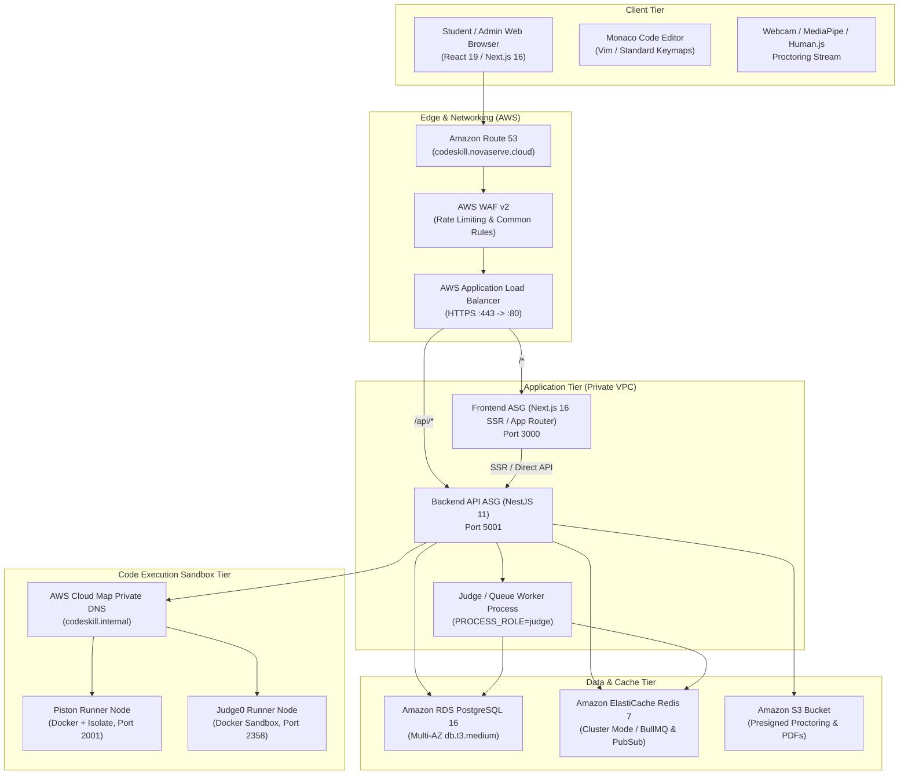
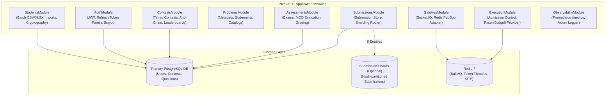
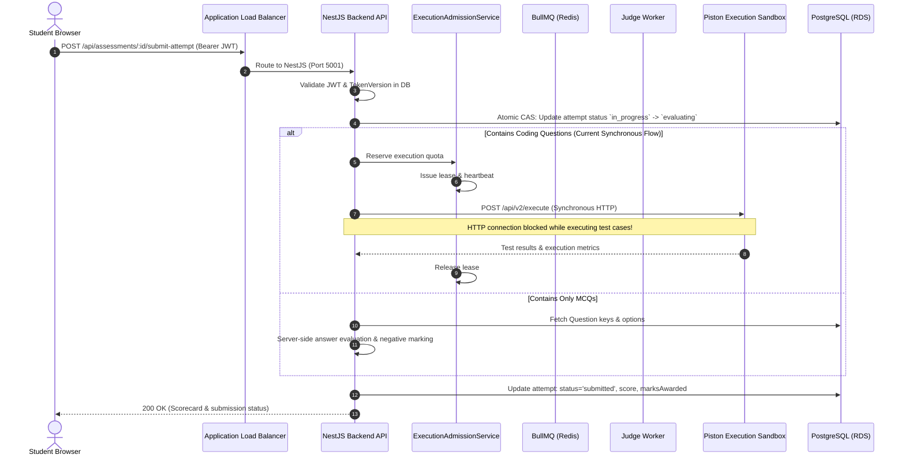
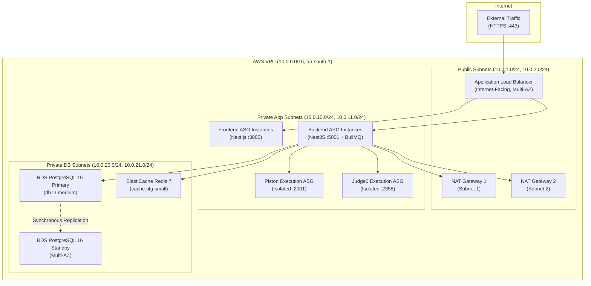

# Architecture Analysis & System Reconstruction

**Platform:** CodeSkill Examination & Online Judge System  
**Repository State:** `f0b6f591b012407137979a39befc9f8b5544ede7`  
**Discipline:** Principal Software Architect & Distributed Systems Engineer

---

## 1. System Context & High-Level Architecture

CodeSkill is structured as a decoupled two-tier application with dedicated background execution nodes and database services.



---

## 2. Component Architecture & Boundaries



---

## 3. End-to-End Request Lifecycle: Assessment Submission



---

## 4. Authentication, Session & Token Rotation Lifecycle

```mermaid
sequenceDiagram
    autonumber
    actor User as Client
    participant API as AuthController / TokenService
    participant DB as PostgreSQL (Users & RefreshTokens)

    User->>API: POST /api/auth/login (email/uid, password)
    API->>DB: Find user by email/uid/username (ILike escaped)
    API->>API: bcrypt.compare(password, user.password)
    API->>DB: Generate familyId; store SHA-256 hash(refreshToken)
    API-->>User: Return accessToken (15m-24h) + refreshToken (raw)

    Note over User,API: Normal API Requests with Bearer accessToken

    User->>API: GET /api/problems (with expired accessToken)
    API-->>User: 401 Unauthorized

    User->>API: POST /api/auth/refresh { refreshToken }
    API->>DB: Lookup token by hash(refreshToken)
    alt Valid and Active
        API->>DB: Mark old token revoked, replace with newToken (same familyId)
        API-->>User: Return new accessToken + new refreshToken
    else Reused Revoked Token (Token Theft Detected!)
        API->>DB: Revoke entire token family (familyId) & increment user.tokenVersion
        API-->>User: 401 Unauthorized (Session Expired, please log in)
    end
```

---

## 5. Deployment and Network Topology



---

## 6. Single Points of Failure & Architectural Weaknesses

### 6.1 Architectural Single Points of Failure (SPOF)
1. **Single Piston/Judge0 Execution Node:**
   While the application ASGs have minimum sizes of 2, the Piston ASG (`min_size = 1`) and Judge0 ASG (`min_size = 1`) each run as a single instance. If the Piston EC2 instance encounters an out-of-memory kernel panic (OOM) from a hostile student loop, all code execution across the platform stops until the ASG health check replaces the node (180s+ delay).
2. **Synchronous Code Execution in HTTP Request Lifecycle:**
   When students submit assessments containing coding problems (`AssessmentsService.submitAttempt`), execution against test cases occurs synchronously within the HTTP handler. A surge of submissions creates an HTTP thread queue, exceeding the ALB 300s idle timeout and dropping student scores.
3. **Primary PostgreSQL Database Writes:**
   All mutations (users, questions, attempts, submissions, audit logs) funnel through the single RDS primary writer instance. Even with submission sharding enabled, all non-submission tables remain on the primary.

### 6.2 Trust Boundaries and Isolation Domains
- **External Client to ALB:** Untrusted. Protected by AWS WAF, TLS 1.3, and CORS policy.
- **ALB to Backend:** Perimeter boundary. Headers (`X-Forwarded-For`, `X-Forwarded-Proto`) trusted only from loopback/local proxies.
- **Backend to Execution Sandbox:** Critical security boundary. Student code runs in isolated containers (Docker + Linux Isolate / cgroups v2).
- **Flaw in Isolation:** The Judge0 runner template grants `CAP_SYS_ADMIN` and `no-new-privileges:false`, weakening this boundary.
