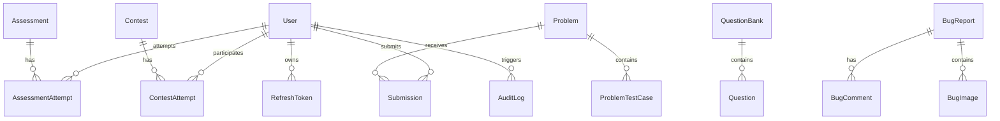

# Database Architecture, Query Performance & Schema Audit

**Platform:** CodeSkill Platform  
**Target Repository:** `/Users/venkateshk22/Documents/codeskill`  
**Discipline:** Database Architect & Performance Engineer  
**Database Engine:** PostgreSQL 16 on Amazon RDS / Local Docker

---

## 1. Schema Architecture & Entity Relationships

The relational schema comprises **33 core entities** managed via TypeORM (`DatabaseModule`):



### 1.1 Declarative Partitioning & Sharding
- **Declarative Partitioning:** Implemented in `backend-nestjs/src/database/migrations/declarative-partitioning.ts`. The `submissions` table is partition-ready by range / hash to prevent table bloat over millions of student testcase runs.
- **Submission Sharding:** `SubmissionStore` routes submission reads and writes to distinct physical PostgreSQL shards based on `userId` hash when `SUBMISSION_SHARDS` is configured.

---

## 2. Query Performance & Indexing Analysis

### 2.1 Index Inventory & Gaps

| Table | Column(s) | Index Name / Status | Assessment |
| :--- | :--- | :--- | :--- |
| `submissions` | `(userId, problemId, status)` | `IDX_sub_user_prob_status` | **EXCELLENT:** Covers student problem history queries |
| `submissions` | `createdAt` | `IDX_sub_created_at` | **GOOD:** Enables time-range filtering for leaderboards |
| `assessment_attempts` | `(assessmentId, studentId)` | Composite unique constraint | **EXCELLENT:** Prevents duplicate student attempts |
| `users` | `email` | Unique Index | **EXCELLENT:** Enforces single account per email |
| `users` | `uid` | Unique Index | **EXCELLENT:** Enforces single account per student UID |
| `users` | `isActive` | **MISSING INDEX** | **GAP:** `count({ where: { isActive: true } })` causes sequential scan (`AUD-DAT-002`) |
| `users` | `forcePasswordChange` | **MISSING INDEX** | **GAP:** Filter queries scan the entire table (`AUD-DAT-002`) |
| `contests` | `slug` | Unique Index | **EXCELLENT:** Fast lookups by URL slug |

### 2.2 Redundant Table-Wide Count Queries (`AUD-DAT-002`)
In `backend-nestjs/src/students/students.service.ts` (lines 94-99):
```typescript
const [students, total] = await qb.getManyAndCount();
const activeCount = await this.userRepository.count({ where: { isActive: true } });
const pendingPasswordResetCount = await this.userRepository.count({ where: { forcePasswordChange: true } });
```
- **Performance Impact:**
  On every page load of the student management table in the admin panel:
  1. `qb.getManyAndCount()` executes 2 queries (the paginated data + total count).
  2. `this.userRepository.count(...)` executes a full table scan on `users` for `isActive = true`.
  3. `this.userRepository.count(...)` executes a second full table scan on `users` for `forcePasswordChange = true`.
  Total: 4 queries per pagination click, 2 of which are un-indexed full scans.
- **Optimization:**
  Remove these two queries from `findAll`. Create a dedicated `/api/students/stats` endpoint and cache the result in Redis with a 5-minute TTL.

---

## 3. Database Connection Pool Architecture & Limits

### 3.1 Pool Sizing Under Autoscaling
In `database.module.ts`:
```typescript
const poolConfig = {
  max: parseInt(process.env.DB_POOL_MAX || '50', 10),
  min: parseInt(process.env.DB_POOL_MIN || '5', 10),
  idleTimeoutMillis: 30000,
  connectionTimeoutMillis: 5000,
};
```
In `backend.sh.tftpl`: `DB_POOL_MAX=15`.

### 3.2 Connection Exhaustion Calculation
$$\text{Total Connections} = (N_{nodes} \times N_{pm2} \times \text{DB\_POOL\_MAX}) + \text{Worker Connections} + \text{Admin Reserve}$$
- If 6 backend instances run in production with 1 API + 1 Judge worker per instance:
  $$\text{API Connections} = 6 \times 1 \times 15 = 90 \text{ connections}$$
  $$\text{Worker Connections} = 6 \times 1 \times 5 = 30 \text{ connections}$$
  $$\text{Total Connections} = 120 \text{ connections}$$
- On a `db.t3.medium` instance, if `max_connections` is tuned to 150, this operates safely. However, if `DB_POOL_MAX` were ever left at its default of 50:
  $$6 \times 50 = 300 \text{ connections} > \text{RDS default limit}$$
  Resulting in fatal connection starvation.
- **Rule:** `DB_POOL_MAX` must be strictly capped at 10-15 per instance in production environments without PgBouncer.

---

## 4. Migration Safety & DDL Transaction Isolation
- All database migrations in `backend-nestjs/src/database/migrations/` follow the non-destructive expand/contract pattern:
  - Columns added with safe defaults.
  - Foreign key constraints created with explicit names.
  - Advisory lock `SELECT pg_advisory_xact_lock(1902230159)` guarantees serialized execution across horizontally scaled clusters.
