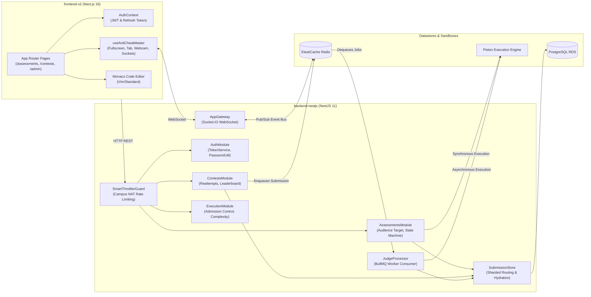
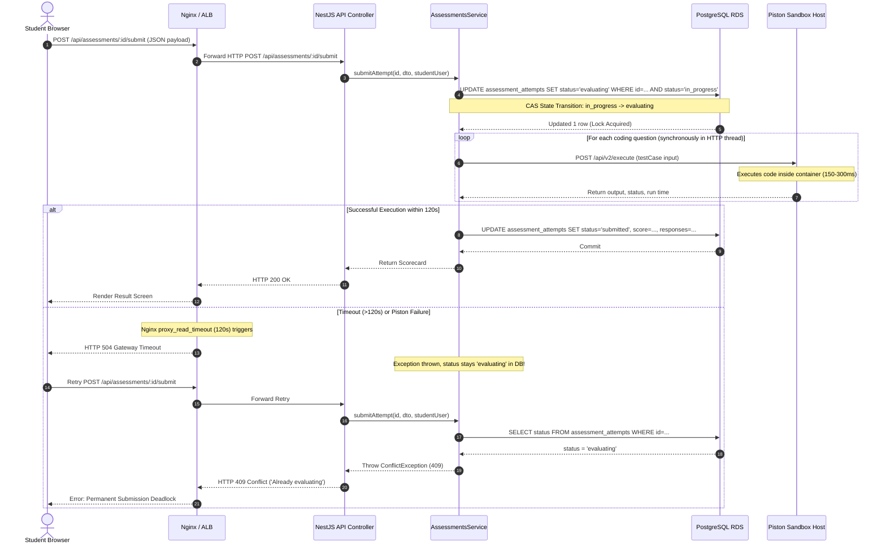
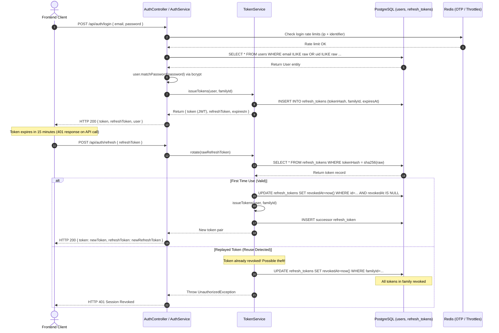
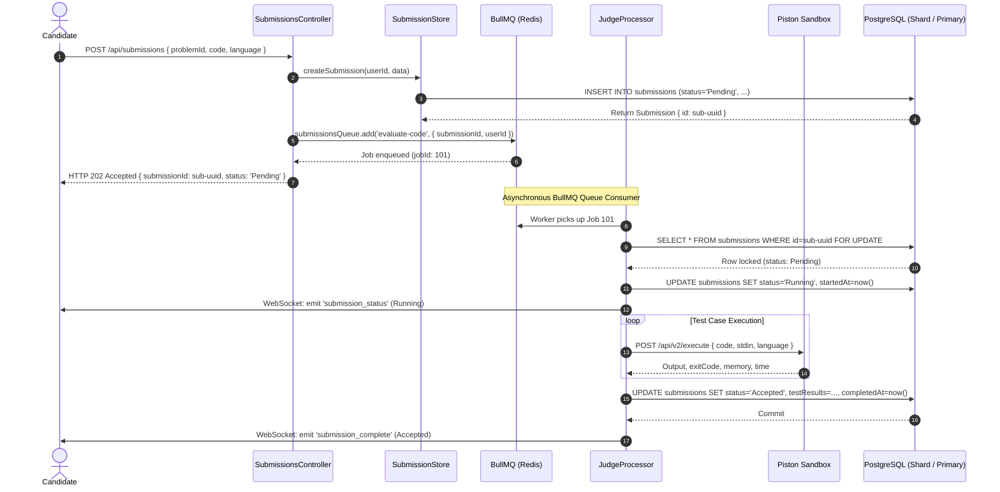
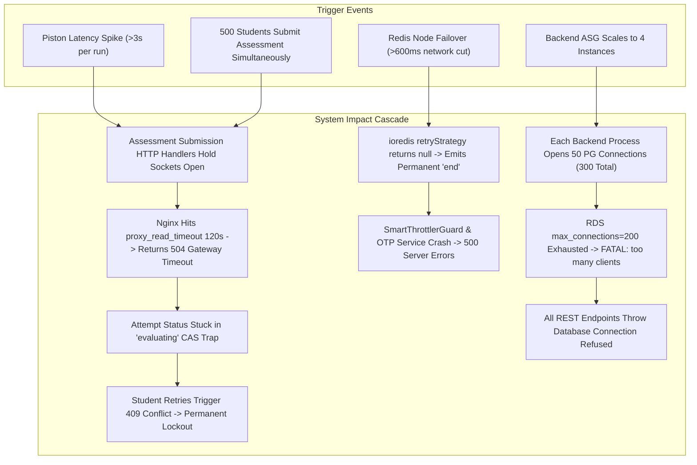

# 02. SYSTEM ARCHITECTURE RECONSTRUCTION & ANALYSIS

**Audited Commit:** `7c83df6ef13915c1171dd4b3e61f31a0c24306e2`  
**Discipline:** Principal Software Architect, Distributed Systems Engineer, Cloud Infrastructure Architect

---

## 1. System Overview & Technology Stack

The CodeSkill platform is a distributed examination, online judge, and automated proctoring platform designed for academic institutions (e.g., Chandigarh University) and corporate recruiting.

### 1.1 Core Technology Inventory

| Layer | Technology | Version / Configuration | Runtime Environment |
|---|---|---|---|
| **Frontend Framework** | Next.js (App Router) | 16.2.9, React 19.2.4 | Node.js 20 on EC2 via PM2 |
| **Frontend State / UI** | Zustand 5, Tailwind CSS 4, Radix UI, Monaco Editor | `monaco-editor` 0.57.0 | Client Browser (Chrome, Edge, Firefox) |
| **Backend Framework** | NestJS | 11.0.1, Express 5 platform adapter | Node.js 20 on EC2 via PM2 |
| **API Architecture** | REST API (`/api`), WebSocket (`/socket.io`), GraphQL (Internal Apollo) | Express 5, Socket.IO 4.8.3, Apollo 13 | Port 5001 (Internal) |
| **Primary Database** | PostgreSQL RDS (Multi-AZ) | 16.x / `db.t3.medium` (4 GiB RAM) | Private Database Subnet |
| **Submission Sharding** | PostgreSQL Shards (Optional) | `SubmissionStore` router over user hash | Multi-instance PG databases |
| **Caching & Queues** | Amazon ElastiCache Redis | Redis 7 OSS, BullMQ 5.80.2 | `cache.t4g.small` (1 Node Group, 1 Replica) |
| **Execution Engines** | Piston & Judge0 API | Isolated Docker engines on EC2 | Private App Subnet (Ports 2001 & 2358) |
| **Storage & Email** | AWS S3, AWS SES | `@aws-sdk/client-s3`, `@aws-sdk/client-ses` | IAM Role authentication |
| **Reverse Proxy / LB** | Nginx & AWS Application Load Balancer | Nginx 1.24+, AWS ALB | Public Subnets (Ports 80 / 443) |
| **Infrastructure as Code** | HashiCorp Terraform | Terraform >= 1.5.0, AWS Provider ~> 5.0 | `terraform/environments/production` |

---

## 2. Reconstructed System Architecture Diagrams

### 2.1 System Context Diagram (C4 Level 1)

```mermaid
flowchart TD
    Student["Student / Candidate (Browser)"]
    Admin["Academic Admin / Teacher"]
    Recruiter["Corporate Recruiter"]

    subgraph AWS_Cloud["AWS Cloud (Production VPC)"]
        ALB["Application Load Balancer (ALB)\nPorts 80/443"]
        
        subgraph Compute_Tier["EC2 Auto Scaling Groups"]
            FrontendASG["Frontend ASG\nNext.js App Router (Port 3000)"]
            BackendASG["Backend ASG\nNestJS API & Judge Worker (Port 5001)"]
            PistonASG["Piston Execution ASG\nSandboxed Runtimes (Port 2001)"]
            Judge0ASG["Judge0 Execution ASG\nAlternative Sandbox (Port 2358)"]
        end

        subgraph Data_Tier["Managed Data & Cache Services"]
            RDS["Amazon RDS PostgreSQL\nPrimary Database (Port 5432)"]
            ElastiCache["ElastiCache Redis 7\nBullMQ Queue & Session Cache (Port 6379)"]
            S3["Amazon S3 Bucket\nAvatars & Proctoring Captures"]
        end
    end

    Student -->|HTTPS / WSS| ALB
    Admin -->|HTTPS| ALB
    Recruiter -->|HTTPS| ALB

    ALB -->|/api/* & /socket.io/*| BackendASG
    ALB -->|/* (Pages)| FrontendASG
    FrontendASG -->|Server-Side Internal /api| BackendASG
    BackendASG -->|SQL Queries| RDS
    BackendASG -->|PubSub / BullMQ / Cache| ElastiCache
    BackendASG -->|HTTP Run Code| PistonASG
    BackendASG -->|HTTP Alternative Judge| Judge0ASG
    BackendASG -->|Upload Captures / Assets| S3
```

---

### 2.2 Component Architecture Diagram (C4 Level 2)



---

### 2.3 Request Lifecycle Sequence Diagram (Assessment Code Execution)



---

### 2.4 Authentication & Token Rotation Flow



---

### 2.5 Data Flow and Storage Topology

```mermaid
flowchart TD
    subgraph Client_Layer["Client Layer"]
        Browser["Student / Admin Browser"]
    end

    subgraph Ingress_Layer["Ingress & Edge"]
        WAF["AWS WAF (Web Application Firewall)"]
        ALB["Application Load Balancer"]
        Nginx["Nginx Reverse Proxy"]
    end

    subgraph App_Layer["Application Compute"]
        API["NestJS API Cluster (Port 5001)"]
        Worker["Judge Worker Process (BullMQ)"]
    end

    subgraph Data_Storage["Persistent & Cache Storage"]
        subgraph RDS_Cluster["PostgreSQL Primary RDS"]
            UsersTable[users / refresh_tokens]
            AssessTable[assessments / assessment_attempts]
            ContestTable[contests / contest_attempts]
            PartitionedSub[submissions (Monthly Range Partitions)]
            AuditTable[audit_logs / exam_security_events]
        end

        subgraph Shard_Cluster["Optional Shards (SUBMISSION_SHARDS)"]
            ShardA[(PostgreSQL Shard A\nSubmissions 0-1023)]
            ShardB[(PostgreSQL Shard B\nSubmissions 1024-2047)]
        end

        subgraph Cache_Queue["In-Memory Infrastructure"]
            RedisQueue[BullMQ 'submissions' Queue]
            RedisThrottle[Throttler Storage & OTP Pepper]
            RedisWS[Socket.IO Redis Adapter Pub/Sub]
        end

        subgraph Object_Storage["Amazon S3"]
            S3Avatars[avatars/]
            S3Proctoring[proctoring/]
        end
    end

    Browser --> WAF --> ALB --> Nginx --> API
    API -->|Write Users / Attempts| UsersTable
    API -->|Write Assessments| AssessTable
    API -->|Write Contests| ContestTable
    API -->|Non-Sharded Submissions| PartitionedSub
    API -->|Route by UserId| ShardA & ShardB
    API -->|Enqueue Runs| RedisQueue
    API -->|Rate Limits & Cooldowns| RedisThrottle
    API -->|Broadcast Exam Events| RedisWS
    API -->|Store Captures| S3Proctoring
    API -->|Store Avatars| S3Avatars

    Worker -->|Fetch Jobs| RedisQueue
    Worker -->|Save Verdicts| PartitionedSub
    Worker -->|Save Sharded Verdicts| ShardA & ShardB
```

---

### 2.6 Critical Write Transaction: Contest Submission & Judging Sequence



---

### 2.7 Deployment and Network Topology

```mermaid
flowchart TD
    Internet((Public Internet))

    subgraph AWS_VPC["AWS VPC (10.0.0.0/16)"]
        subgraph Public_Subnets["Public Subnets (AZ-a, AZ-b)"]
            IGW["Internet Gateway"]
            ALB["Application Load Balancer\n(Internet-Facing, TLS 1.3)"]
            NAT["NAT Gateways (Egress)"]
        end

        subgraph Private_App_Subnets["Private App Subnets (10.0.10.0/24, 10.0.11.0/24)"]
            FE_ASG["Frontend ASG\nNext.js 16 (Ports 3000)\nDesired: 2, Max: 6"]
            BE_ASG["Backend ASG\nNestJS API & Worker (Port 5001)\nDesired: 2, Max: 6"]
            Piston_ASG["Piston Execution ASG\nDocker Engine (Port 2001)\nDesired: 1, Max: 8"]
            Judge0_ASG["Judge0 Execution ASG\nDocker Engine (Port 2358)\nDesired: 1, Max: 4"]
            CloudMap["AWS Cloud Map\n(codeskill.internal DNS)"]
        end

        subgraph Private_DB_Subnets["Private DB Subnets (10.0.20.0/24, 10.0.21.0/24)"]
            RDS_PG["Amazon RDS PostgreSQL 16\ndb.t3.medium (4 GiB RAM)\nMulti-AZ Replica"]
            Redis_Cluster["ElastiCache Redis 7\ncache.t4g.small\n1 Primary + 1 Replica"]
        end
    end

    Internet <--> IGW <--> ALB
    ALB -->|Port 3000| FE_ASG
    ALB -->|Port 5001| BE_ASG

    FE_ASG --> NAT
    BE_ASG --> NAT
    Piston_ASG --> NAT

    BE_ASG -->|Port 5432| RDS_PG
    BE_ASG -->|Port 6379| Redis_Cluster
    BE_ASG -->|Port 2001 (Cloud Map)| Piston_ASG
    BE_ASG -->|Port 2358 (Cloud Map)| Judge0_ASG

    Piston_ASG -.->|Register Instance| CloudMap
    Judge0_ASG -.->|Register Instance| CloudMap
```

---

### 2.8 Failure Propagation Diagram



---

### 2.9 External Integration Boundaries

```mermaid
flowchart LR
    subgraph CodeSkill_Core["CodeSkill Core Platform"]
        API["NestJS Backend"]
        Frontend["Next.js Frontend"]
    end

    subgraph AWS_Services["AWS Managed Services"]
        S3["AWS S3 (Captures & Avatars)"]
        SES["AWS SES (Transacational Emails & OTP)"]
        CloudWatch["AWS CloudWatch (Metrics & Logs)"]
        SSM["AWS SSM Parameter Store (Secrets & Runtime Config)"]
    end

    subgraph Third_Party["Third-Party External Services"]
        GoogleOAuth["Google OAuth 2.0 (Authentication)"]
        GitHubOAuth["GitHub OAuth 2.0"]
        LinkedInOAuth["LinkedIn OAuth 2.0"]
        OpenRouter["OpenRouter / OpenPipe (AI Student Tutor)"]
        Axiom["Axiom Logging (Cloud Observability)"]
    end

    API -->|SDK| S3
    API -->|SDK| SES
    API -->|Agent / SDK| CloudWatch
    API -->|SDK| SSM

    Frontend -->|Client OAuth Redirect| GoogleOAuth
    API -->|Token Verification| GoogleOAuth
    API -->|Token Verification| GitHubOAuth
    API -->|Token Verification| LinkedInOAuth
    API -->|Inference (Graceful Degradation)| OpenRouter
    API -->|Winston Log Streams| Axiom
```

---

## 3. Single Points of Failure (SPOF) Analysis

1. **RDS Single Writer Instance:**
   Although RDS is configured for Multi-AZ (`multi_az = true`), PostgreSQL operates as an active-passive instance. During automatic failover, writer DNS migration requires 60–120 seconds. If an active examination is underway, all ongoing transactions will be aborted.
2. **Piston ASG Single Desired Instance:**
   `terraform/environments/production/main.tf:404-406` defines `min_size = 1, desired_capacity = 1`. If the single Piston instance crashes, experiences Docker daemon failure, or exhausts cgroup memory, all code execution across both practice and assessments ceases until the ASG detects failure (grace period: 180s) and spins up a replacement.
3. **ElastiCache Single Replication Group Node:**
   `terraform/modules/redis/main.tf:74` configures `num_node_groups = 1`. While automatic failover is enabled with 1 replica, the connection termination bug in `ioredis` (`retryStrategy` returning `null`) turns a momentary Redis failover into a permanent application failure.
4. **Synchronous Assessment Submission Pipeline:**
   Because assessment grading is not decoupled via BullMQ or asynchronous message workers, the NestJS HTTP API server is a critical SPOF for grading completion. If an instance restarts or scales down during exam submission, in-progress evaluations are lost.

---

## 4. Trust Boundaries & Data Governance

1. **Client / Browser vs. API Boundary:**
   The browser is treated as untrusted. Anti-cheat events (tab switch, fullscreen exits, face verification warnings) are reported from the client. The server tracks counts and enforces state transitions. However, `SmartThrottlerGuard` trusts the incoming `X-Forwarded-For` header for unauthenticated tracking.
2. **API vs. Code Execution Sandbox Boundary:**
   Untrusted student code is submitted to Piston. Piston is intended to sandbox execution via Linux namespaces, cgroups, and non-root users (`piston:piston`). However, the production launch script runs the container with `--privileged` and failed to disable networking, which violates this trust boundary and exposes the underlying EC2 host and IAM credentials.
3. **Primary Database vs. Submission Shard Boundary:**
   User accounts and credentials exist exclusively on the primary PostgreSQL database. Submission shards do not have foreign key constraints to primary tables (`users`, `problems`), requiring all referential integrity to be maintained in application code (`SubmissionStore`).
