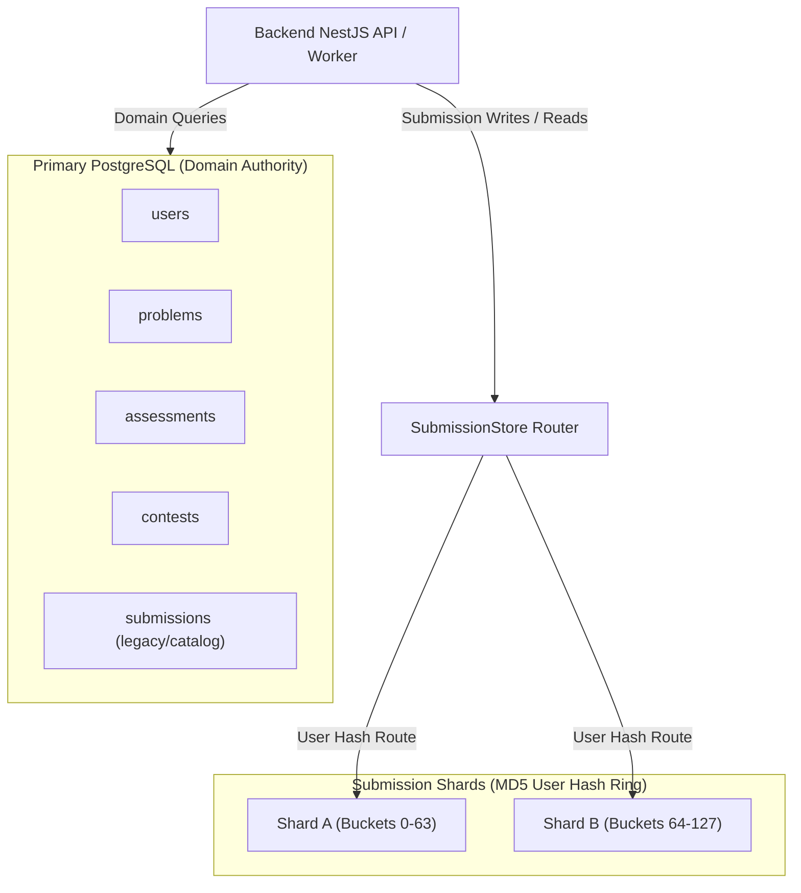
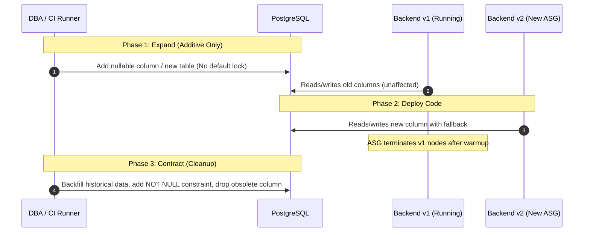

# 03 — Database Migration & Sharding Operations Protocol

This document details the database architecture, schema migration safeguards, distributed advisory locking protocols, and sharding cutover procedures for CodeSkill.

---

## 1. Architecture Overview

CodeSkill utilizes a hybrid relational and sharded PostgreSQL persistence architecture:
1. **Primary PostgreSQL Database**:
   - Houses authoritative domain entities: `User`, `Problem`, `Assessment`, `Contest`, `Company`, `Campus`, `Discussion`, `Report`.
   - Maintains submission metadata and legacy submissions.
2. **Horizontal Submission Shards (Optional / High-Scale)**:
   - Partitioned by `userId` using a deterministic 128-bucket MD5 hash ring:
     $$\text{bucket} = ((\text{'x'} \mathbin{\Vert} \text{substr}(\text{md5}(\text{lower}(\text{userId})), 1, 8))::\text{bit}(32)::\text{bigint}) \pmod{128}$$
   - Owns high-volume student code submissions (`submissions` table) isolated from relational catalog contention.



---

## 2. Remediation of Boot DDL Synchronization (`ISSUE-INF-003`)

### 2.1 The Critical Defect
Previously, the backend launch template user-data script (`backend.sh.tftpl`) executed `npm run typeorm:sync` on container boot across all Auto Scaling Group instances:
- When ASG scaled out under high exam traffic (e.g., from 2 to 6 instances), multiple instances simultaneously ran DDL queries (`CREATE TABLE`, `ALTER TABLE`, `ADD CONSTRAINT`).
- PostgreSQL exclusive catalog locks (`AccessExclusiveLock`) blocked concurrent read/write transactions, creating deadlock chains, query timeouts, and connection pool exhaustion (`504 Gateway Timeout`).

### 2.2 Implemented Zero-Downtime Safe Execution Protocol
1. **Removal of Boot Migrations**:
   - `backend.sh.tftpl` was stripped of all `typeorm:sync` and migration invocations. Backend nodes now boot exclusively in read-execute mode against an already-migrated schema.
2. **Pre-Deployment Migration Gate**:
   - Migrations are now decoupled from application runtime and executed exclusively in CI/CD pre-deployment runners or dedicated bastion jobs before new ASG launch templates are rolled out.
3. **Advisory Locking Pattern**:
   - Every standalone migration runner must acquire a session-level PostgreSQL advisory lock before executing DDL:
   ```sql
   SELECT pg_advisory_lock(847291048291);
   -- Run migration scripts inside transaction
   SELECT pg_advisory_unlock(847291048291);
   ```
   If another migration runner holds the lock, subsequent runners wait or safely exit without corrupting catalog state.

---

## 3. Zero-Downtime Schema Evolution (Expand / Contract Pattern)

All future schema changes must follow the phased **Expand / Contract** pattern to ensure full backward compatibility with running backend instances during rollouts:



### 3.1 Strict DDL Rules for Production Migrations
- **Never `ALTER TABLE ... ADD COLUMN ... DEFAULT ...` without PostgreSQL 11+ metadata-only defaults**: Ensure additions do not rewrite entire tables.
- **Never rename columns in-place**: Create a new column, dual-write via service logic, backfill in batches, switch readers, and drop the legacy column in a subsequent release.
- **Always build indexes concurrently**:
  ```sql
  CREATE INDEX CONCURRENTLY idx_submissions_created_at_id ON submissions (created_at DESC, id DESC);
  ```
  `CREATE INDEX CONCURRENTLY` prevents table-level write locks.

---

## 4. Shard Migration and Cutover Protocol

When enabling or expanding submission shards (`run-submission-sharding.ts` and `migrate-submission-shards.ts`):

### 4.1 Pre-Migration Checklist
- [ ] Confirm full database backup completed via `pg_dump` or AWS RDS automated snapshot.
- [ ] Ensure all submission worker queues (`submissions`, `grading`) are drained and paused.
- [ ] Verify connectivity and credentials for primary RDS and all target shard databases.
- [ ] Confirm `SUBMISSION_SHARDS` environment variable contains identical shard definitions across all API and judge nodes.

### 4.2 Migration Execution
Execute shard migration with explicit flags from a maintenance runner:
```bash
(cd backend-nestjs && NODE_ENV=production npm run db:shards:migrate -- --apply --writers-stopped)
```

The migration runner performs:
1. Verification of writers-stopped flag to avoid concurrent race conditions.
2. DDL synchronization on target shard tables.
3. Batched cursor-based migration of submissions from primary database to target shards based on MD5 user routing.
4. Validation that all rows match target bucket boundaries.

### 4.3 Post-Migration Verification
Execute the verification script to validate topology integrity and confirm zero misplaced submissions:
```bash
(cd backend-nestjs && NODE_ENV=production npm run db:shards:verify)
```
Expected output:
```json
{
  "active": true,
  "routingBuckets": 128,
  "totalSubmissions": 145020,
  "shards": [
    { "id": "shard-a", "rows": 72480, "misplaced": 0 },
    { "id": "shard-b", "rows": 72540, "misplaced": 0 }
  ]
}
```

### 4.4 Rollback Strategy
If `misplaced > 0` or cutover fails:
1. Primary database submissions table remains fully intact and un-truncated during migration.
2. Re-point `SUBMISSION_SHARDS=""` to immediately revert the application to primary store reads and writes without data loss.
3. Drain target shard connections and investigate shard routing logs.
