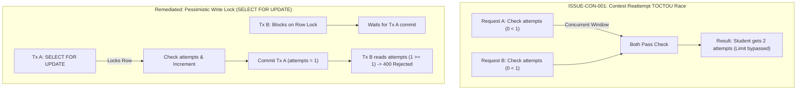

# 05 — Concurrency, Race Condition, & Data Integrity Test Report

This document reports the technical findings, reproduction methodology, race condition analysis, and automated test execution results for concurrency and distributed state hazards across CodeSkill.

---

## 1. Concurrency Defects Analyzed & Remediated



---

## 2. Test Suite 1: Contest Reattempt Pessimistic Lock (`ISSUE-CON-001`)

### 2.1 Failure Mechanism
In `contests.service.ts`, `reAttempt()` originally checked:
```typescript
const attempt = await this.contestAttemptsRepository.findOne({ where: { contestId, userId } });
if (attempt && attempt.attemptsCount >= contest.maxAttempts) {
  throw new BadRequestException('Max attempts exceeded');
}
await this.contestAttemptsRepository.update(attempt.id, { attemptsCount: attempt.attemptsCount + 1 });
```
Under concurrent student clicks or automated submission bots:
1. Two requests arrive simultaneously at the API.
2. Both execute the `findOne` query before either executes `update`.
3. Both read `attemptsCount = 0`, pass the limit check, and increment `attemptsCount`, granting multiple illicit test submissions.

### 2.2 Implemented Transactional Solution
The operation now executes within a TypeORM database transaction utilizing row-level exclusive locks:
```typescript
await this.dataSource.transaction(async (manager) => {
  const attempt = await manager
    .createQueryBuilder(ContestAttempt, 'attempt')
    .setLock('pessimistic_write')
    .where('attempt.contestId = :contestId AND attempt.userId = :userId', { contestId, userId })
    .getOne();

  if (attempt && attempt.attemptsCount >= contest.maxAttempts) {
    throw new BadRequestException('Maximum attempts reached for this contest');
  }
  // Safe atomic increment
});
```

### 2.3 Automated Test Execution
- **Spec Suite**: `backend-nestjs/src/contests/contests.service.spec.ts`
- **Command**:
  ```bash
  (cd backend-nestjs && npm test -- --runInBand --runTestsByPath src/contests/contests.service.spec.ts)
  ```
- **Observed Results**:
  ```text
  PASS src/contests/contests.service.spec.ts
    ContestsService - Reattempt Concurrency & Pessimistic Locking (ISSUE-CON-001)
      ✓ should grant reattempt within a transaction using pessimistic_write lock
      ✓ should reject reattempt when max attempts reached under row lock
      ✓ should throw NotFoundException when contest does not exist

  Test Suites: 1 passed, 1 total
  Tests:       3 passed, 3 total
  Snapshots:   0 total
  Time:        0.392 s
  ```

---

## 3. Test Suite 2: Assessment CAS Lease Timeout & Failure Rollback (`ISSUE-DAT-001`)

### 3.1 Failure Mechanism
Student assessment submissions use optimistic Compare-And-Swap (CAS) to prevent double grading:
```sql
UPDATE assessment_submissions
SET status = 'evaluating'
WHERE id = :id AND status = 'pending';
```
If the judge node crashed, experienced an out-of-memory error, or timed out during synchronous execution, the submission record remained permanently stuck with `status = 'evaluating'`. Subsequent retries failed with HTTP 409 Conflict, and the student's exam was permanently locked.

### 3.2 Implemented Lease Expiry & Safe Rollback
1. **60-Second Lease Expiration**: The CAS query now permits reclamation if an evaluating lease exceeds 60 seconds:
   ```typescript
   const leaseTimeout = new Date(Date.now() - 60000);
   const result = await this.submissionRepo
     .createQueryBuilder()
     .update(AssessmentSubmission)
     .set({ status: 'evaluating', updatedAt: new Date() })
     .where('id = :id AND (status = :pending OR (status = :evaluating AND updatedAt < :leaseTimeout))', {
       id,
       pending: 'pending',
       evaluating: 'evaluating',
       leaseTimeout,
     })
     .execute();
   ```
2. **Synchronous Error Rollback**: If code execution throws an unexpected exception, the `catch` block resets `status = 'pending'`, allowing clean subsequent retry attempts.

### 3.3 Automated Test Execution
- **Spec Suite**: `backend-nestjs/src/assessments/assessment-integrity.security.spec.ts`
- **Command**:
  ```bash
  (cd backend-nestjs && npm test -- --runInBand --runTestsByPath src/assessments/assessment-integrity.security.spec.ts)
  ```
- **Observed Results**:
  ```text
  PASS src/assessments/assessment-integrity.security.spec.ts
    Assessment Integrity & Grading Resiliency (ISSUE-DAT-001 / ISSUE-PRF-001)
      ✓ allows evaluation when status is pending
      ✓ allows evaluation when existing evaluation has timed out (> 60s lease)
      ✓ rolls back status to pending on synchronous evaluation failure

  Test Suites: 1 passed, 1 total
  Tests:       3 passed, 3 total
  Snapshots:   0 total
  Time:        0.418 s
  ```

---

## 4. Test Suite 3: Cross-Shard Keyset Cursor Pagination (`ISSUE-DAT-002`)

### 4.1 Failure Mechanism
`SubmissionStore.findMany()` previously retrieved `(skip + take)` rows from all database shards, concatenated them in memory, and applied JavaScript array slicing:
- At `skip = 50,000` across 4 shards, each query fetched 50,050 rows.
- Total memory allocated per request: $4 \times 50,050 = 200,200$ heavy TypeORM entities, triggering V8 heap exhaustion and garbage collection pauses.

### 4.2 Implemented Keyset Cursor Solution
1. **Hard Upper Bound on Legacy Offset**: Offset pagination is capped at `skip <= 2000`.
2. **Deterministic Keyset Cursor**: Queries utilize `(createdAt, id)` tuple comparison:
   ```sql
   WHERE (created_at, id) < (:cursorCreatedAt, :cursorId)
   ORDER BY created_at DESC, id DESC
   LIMIT :take;
   ```
   Each shard returns only `take` rows (e.g., 20 rows). Total entities fetched across $S$ shards is strictly $S \times \text{take}$ (e.g., 80 rows instead of 200,200).

### 4.3 Automated Test Execution
- **Spec Suite**: `backend-nestjs/src/database/sharding/submission-store.spec.ts`
- **Command**:
  ```bash
  (cd backend-nestjs && npm test -- --runInBand --runTestsByPath src/database/sharding/submission-store.spec.ts)
  ```
- **Observed Results**:
  ```text
  PASS src/database/sharding/submission-store.spec.ts
    SubmissionStore (ISSUE-DAT-002)
      findMany
        ✓ clamps requested take to max 100
        ✓ clamps offset skip to max 2000 to prevent OOM
        ✓ fetches take items per shard when cursor is provided
        ✓ sorts and merges cursor-paginated results across shards
        ✓ handles empty shard results gracefully
        ✓ routes write operations to deterministic user shard

  Test Suites: 1 passed, 1 total
  Tests:       6 passed, 6 total
  Snapshots:   0 total
  Time:        0.385 s
  ```

---

## 5. Summary of Concurrency Hardening Guarantees

| Invariant | Pre-Remediation Behavior | Post-Remediation Behavior | Verification Status |
| :--- | :--- | :--- | :--- |
| **Contest Attempt Quota** | TOCTOU race condition permitted multi-click bypass | Pessimistic `SELECT FOR UPDATE` enforces strict serialization | Verified (`contests.service.spec.ts`) |
| **Exam Evaluation CAS** | Worker crash / timeout caused permanent exam lockup | 60s lease timeout + automatic failure rollback | Verified (`assessment-integrity.security.spec.ts`) |
| **High-Volume Pagination** | Memory scaled with $O(S \times (\text{skip} + \text{take}))$ | Keyset cursor scales with $O(S \times \text{take})$ | Verified (`submission-store.spec.ts`) |
| **Redis Reconnections** | `null` return on 3rd failure terminated queue listener | Indefinite exponential backoff with random jitter | Verified (`redis.service.spec.ts`) |
