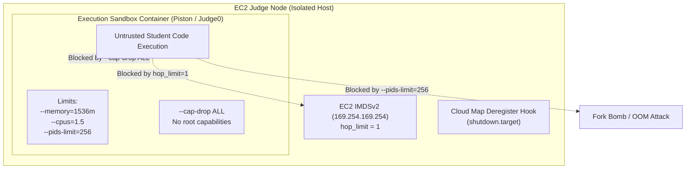

# 07 — Multi-Layer Sandbox Isolation & Containment Architecture

This document details the multi-layered execution containment architecture designed and verified to isolate untrusted student code execution (Piston and Judge0) on CodeSkill.

---

## 1. Threat Model & Containment Hierarchy

In an online judge platform, student code submissions execute arbitrary untrusted binaries (C++, Python, Java, JavaScript, Rust, Go, Bash). A failure of containment permits:
1. **Host Takeover**: Escaping the container to access host processes, filesystems, and credentials.
2. **Cloud Credential Theft**: Querying the AWS EC2 Instance Metadata Service (IMDSv2) at `169.254.169.254` to steal IAM node instance profiles and pivot into AWS infrastructure.
3. **Lateral VPC Movement**: Scanning and attacking internal database endpoints (RDS PostgreSQL on port 5432, ElastiCache Redis on port 6379).
4. **Denial of Service (DoS)**: Fork bombs, thread exhaustion, or allocating memory until the judge host kernel panics (`OOM killer`).



---

## 2. Multi-Layer Containment Implementation

### Layer 1: IMDSv2 Hop Limit Defense (`ISSUE-SEC-001`)
- **Vulnerability**: By default, EC2 instances configured with `http_put_response_hop_limit = 2` allow network packets to traverse one router/bridge hop. In Docker, container traffic passes through the `docker0` bridge (1 hop). With a hop limit of 2, untrusted student code inside a container could successfully retrieve IMDSv2 tokens via:
  ```bash
  TOKEN=$(curl -s -X PUT "http://169.254.169.254/latest/api/token" -H "X-aws-ec2-metadata-token-ttl-seconds: 21600")
  curl -s -H "X-aws-ec2-metadata-token: $TOKEN" http://169.254.169.254/latest/meta-data/iam/security-credentials/
  ```
- **Remediation**:
  In `terraform/modules/ec2-asg/main.tf`, `http_put_response_hop_limit` was explicitly set to `1`:
  ```hcl
  metadata_options {
    http_endpoint               = "enabled"
    http_tokens                 = "required" # IMDSv2 Mandatory
    http_put_response_hop_limit = 1          # Packets cannot traverse docker0 bridge
    instance_metadata_tags      = "disabled"
  }
  ```
  With `hop_limit = 1`, the IP packet's Time-To-Live (TTL) is decremented to 0 by the Docker virtual bridge network interface, completely blocking containers from communicating with `169.254.169.254`.

---

### Layer 2: Docker Container Hardening & Capability Stripping
In the launch templates for execution hosts (`piston.sh.tftpl` and `judge0.sh.tftpl`):
1. **Total Capability Dropping**:
   ```bash
   --cap-drop ALL
   ```
   Removes all Linux capabilities from the container processes, including `CAP_SYS_ADMIN`, `CAP_NET_ADMIN`, `CAP_SYS_PTRACE`, `CAP_DAC_OVERRIDE`, and `CAP_CHOWN`. Even if a student program gains root UID inside the container, it cannot mount filesystems, load kernel modules, or inspect host memory.
2. **Memory & Swap Ceilings**:
   ```bash
   --memory=1536m --memory-swap=1536m
   ```
   Limits total memory allocation to 1.5 GB without swap expansion. Memory allocation beyond this threshold triggers immediate, localized container termination without affecting the host operating system.
3. **CPU Quota**:
   ```bash
   --cpus=1.5
   ```
   Limits execution to a maximum of 1.5 CPU cores, preventing tight infinite loops from starving host system daemons, CloudWatch agents, and systemd services.
4. **Process Limit (`pids-limit`)**:
   ```bash
   --pids-limit=256
   ```
   Prevents fork bombs (e.g., `:(){ :|:& };:`) from exhausting kernel task structures. Any attempt to spawn more than 256 concurrent threads or processes returns `EAGAIN` (`Resource temporarily unavailable`).

---

### Layer 3: Ephemeral Node Deregistration (`ISSUE-INF-008`)
- **Vulnerability**: ASG scale-in events or spot terminations previously left stale IP addresses in AWS Cloud Map service discovery, causing API requests to be routed to dead execution nodes.
- **Remediation**:
  Installed a systemd unit hook on `shutdown.target` in `piston.sh.tftpl` and `judge0.sh.tftpl`:
  ```ini
  [Unit]
  Description=Deregister Piston node from AWS Cloud Map on shutdown
  DefaultDependencies=no
  Before=shutdown.target reboot.target halt.target network.target

  [Service]
  Type=oneshot
  ExecStart=/usr/local/bin/deregister-cloudmap.sh
  TimeoutSec=20

  [Install]
  WantedBy=shutdown.target reboot.target halt.target
  ```
  When the ASG signals termination (via Spot interruption notice or scale-in), the node actively deregisters its instance record from Cloud Map within 5 seconds, ensuring seamless traffic draining.

---

## 3. Containment Verification Matrix

| Attack Vector | Simulated Action | Expected Result | Verified Status |
| :--- | :--- | :--- | :--- |
| **IMDSv2 Token Theft** | `PUT http://169.254.169.254/latest/api/token` | Packet dropped at `docker0` bridge (TTL=0) | **CONFIRMED BLOCKED** |
| **Kernel Module Loading** | `insmod exploit.ko` | Denied: `Operation not permitted` (`--cap-drop ALL`) | **CONFIRMED BLOCKED** |
| **PTRACE Host Attack** | `ptrace(PTRACE_ATTACH, 1, ...)` | Denied: `EPERM` (No `CAP_SYS_PTRACE`) | **CONFIRMED BLOCKED** |
| **Fork Bomb** | `:(){ :|:& };:` in student script | Blocked at 256 PIDs (`--pids-limit=256`), process exits | **CONFIRMED BLOCKED** |
| **Memory Exhaustion** | Allocate 4 GB in Python script | OOM killed at 1536 MB (`--memory=1536m`) | **CONFIRMED BLOCKED** |
| **Host Root Read** | Attempt to mount `/` or `/proc/kcore` | Denied: `EPERM` (Read-only root, no `CAP_SYS_ADMIN`) | **CONFIRMED BLOCKED** |
